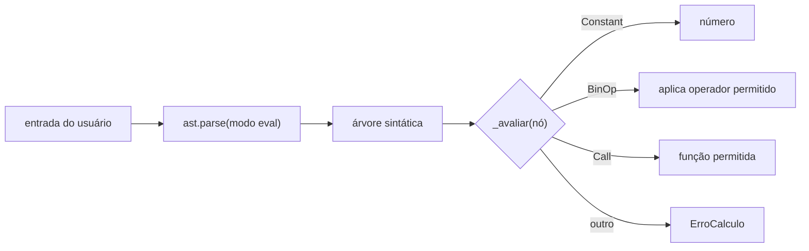

# 🧮 Projeto 01 – Calculadora de Linha de Comando

> [!note] Nível e pré-requisitos
> **Iniciante.** Você precisa dos módulos [[01 - Fundamentos/01 - Instalação e Ambiente|01]], [[02 - Controle de Fluxo e Estruturas de Dados/01 - if elif else e match case|02]] e [[03 - Funções e Modularização/01 - Definindo Funções|03 (funções)]].

## 🎯 Objetivo

Criar uma calculadora que aceita **expressões completas** (`2 + 3 * (4 - 1)`), com funções (`sqrt(16)`), constantes (`pi`), histórico e a variável `ans` (último resultado), tanto em **modo interativo** quanto em **modo direto** (`python calculadora.py "2+2"`).

## ✅ Requisitos

| # | Requisito |
|---|---|
| R1 | Operações `+ - * / // % **` e parênteses, respeitando a precedência |
| R2 | Funções `sqrt`, `abs`, `round` e constantes `pi`, `e` |
| R3 | Variável `ans` com o último resultado |
| R4 | Erros amigáveis (divisão por zero, sintaxe inválida) **sem derrubar** o programa |
| R5 | Comandos `historico` e `sair` no modo interativo |
| R6 | **Segurança:** nunca usar `eval()` direto com texto do usuário |

> [!warning] Por que não `eval()`?
> ```python
> eval(input("> "))     # ❌ o usuário pode digitar __import__("os").system("rm -rf ~")
> ```
> Vamos usar o módulo `ast` para **ler** a expressão e executar só o que permitirmos (lista branca).

## 🗺️ Arquitetura



## 🪜 Passo a passo

### Passo 1 – Versão ingênua (para entender o problema)

```python
a = float(input("a: "))
op = input("op: ")
b = float(input("b: "))
if op == "+":
    print(a + b)
# ...
```

Funciona, mas só faz **uma operação por vez**. Evoluir para expressões exige um *parser*.

### Passo 2 – Mapear operadores permitidos

```python
import ast
import operator

OPERADORES = {
    ast.Add: operator.add,
    ast.Sub: operator.sub,
    # TODO: Mult, Div, FloorDiv, Mod, Pow
}
```

> [!tip] Dica
> `operator.add(2, 3)` equivale a `2 + 3`. Veja [[07 - Programação Funcional e Intermediário/01 - Funções de Ordem Superior|Funções de Ordem Superior]].

### Passo 3 – Avaliar a árvore

Use `match/case` sobre os nós:

```python
def _avaliar(no):
    match no:
        case ast.Constant(value=int() | float() as v):
            return v
        case ast.BinOp(left=esq, op=op, right=dir):
            ...   # TODO: buscar op em OPERADORES e aplicar
        case _:
            raise ErroCalculo("operação não permitida")
```

> [!example] Veja a árvore no REPL
> ```python
> >>> import ast
> >>> print(ast.dump(ast.parse("1+2*3", mode="eval"), indent=2))
> ```

### Passo 4 – Funções, constantes e `ans`

Adicione os casos `ast.Name` (constantes/variáveis) e `ast.Call` (funções).

### Passo 5 – Laço interativo

```python
while True:
    texto = input(">>> ").strip()
    ...
```

Trate `KeyboardInterrupt`/`EOFError` (Ctrl+C / Ctrl+D) para sair com elegância.

### Passo 6 – Modo direto via `sys.argv`

```python
import sys
if len(sys.argv) > 1:
    print(avaliar(" ".join(sys.argv[1:])))
```

## 🧪 Casos de teste

| Entrada | Esperado |
|---|---|
| `2 + 3 * 4` | `14` |
| `(2 + 3) * 4` | `20` |
| `2 ** 10` | `1024` |
| `sqrt(16) + 1` | `5` |
| `10 / 0` | erro amigável |
| `__import__('os')` | erro: não permitido |
| `ans * 2` (após `5`) | `10` |

## 🏆 Desafios extras

1. Adicionar `sin`, `cos`, `log` (use `math`).
2. Atribuição de variáveis (`x = 5`) com dicionário de ambiente.
3. Salvar o histórico em arquivo entre execuções ([[05 - Tratamento de Erros e Arquivos/03 - Arquivos Texto CSV e JSON|arquivos]]).
4. Escrever testes com `pytest` ([[08 - Avançado/06 - Testes com unittest e pytest|Testes]]).
5. Usar `argparse` para flags como `--precisao 4`.

> [!success] Pronto?
> Compare com a [[09 - Projetos Práticos/Projeto 01 - Solução|Solução do Projeto 01]] — só depois de tentar!

---

⬅️ [[08 - Avançado/09 - Exercícios de Python Avançado|Exercícios do Módulo 08]] | ➡️ [[09 - Projetos Práticos/Projeto 01 - Solução|Solução]]

#python #projeto #iniciante #cli #ast #calculadora
