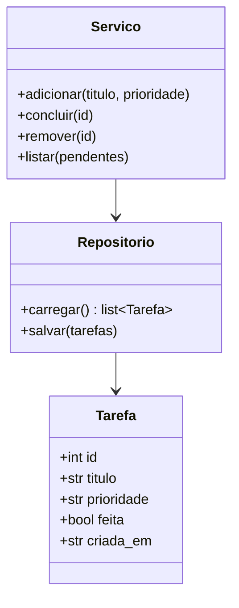

# ✅ Projeto 02 – Gerenciador de Tarefas com Arquivos

> [!note] Pré-requisitos
> [[04 - Programação Orientada a Objetos/05 - Dataclasses e Slots|Dataclasses]], [[05 - Tratamento de Erros e Arquivos/03 - Arquivos Texto CSV e JSON|JSON e arquivos]], [[06 - Módulos da Biblioteca Padrão Essenciais/02 - datetime e time|datetime]] e [[06 - Módulos da Biblioteca Padrão Essenciais/01 - os pathlib e sys|pathlib]].

## 🎯 Objetivo

Um app de terminal que **persiste** tarefas em um arquivo JSON:

```text
$ todo add "Estudar decorators" --prioridade alta
$ todo list
$ todo done 1
$ todo rm 1
```

## ✅ Requisitos

| # | Requisito |
|---|---|
| R1 | Subcomandos `add`, `list`, `done`, `rm` (via `argparse`) |
| R2 | Cada tarefa: `id`, `titulo`, `prioridade` (`baixa/media/alta`), `feita`, `criada_em` |
| R3 | Dados em `~/.todo.json` (ou caminho via variável `TODO_ARQUIVO`) |
| R4 | `list` aceita `--pendentes` e ordena por prioridade |
| R5 | Arquivo ausente ou corrompido **não** pode quebrar o programa |
| R6 | Escrita **atômica**: nunca deixar o arquivo pela metade |

## 🗺️ Modelo



> [!tip] Separe responsabilidades
> Repositório (I/O) ≠ regras (serviço) ≠ interface (argparse). Isso torna cada parte **testável** isoladamente.

## 🪜 Passo a passo

1. **Dataclass `Tarefa`** com `asdict()` para serializar.
2. **`Repositorio.carregar()`**: lê JSON; se não existir → `[]`; se corrompido → avisa e faz backup `.bak`.
3. **`Repositorio.salvar()`**: grava em arquivo temporário e usa `os.replace` (atômico).
4. **`Servico`**: gera `id` incremental (`max(ids, default=0) + 1`).
5. **CLI**: `argparse` com `add_subparsers(dest="cmd", required=True)`.
6. **Saída** formatada: `[ ] 1 (alta) Estudar decorators`.

> [!warning] ❌ Gravação direta
> ```python
> with open(caminho, "w") as f:      # se o programa cair aqui, o arquivo fica vazio!
>     json.dump(dados, f)
> ```
> ✅ Escreva em `caminho.with_suffix(".tmp")` e depois `os.replace(tmp, caminho)`.

## 🧪 Casos de teste

- `add` sem título → erro de argparse.
- `done 99` (id inexistente) → mensagem amigável, código de saída `1`.
- Apagar o arquivo manualmente → o app continua funcionando.
- Colocar `{lixo` no arquivo → backup + lista vazia.

## 🏆 Desafios extras

1. Campo `prazo` (data) e comando `list --atrasadas`.
2. Tags e filtro `--tag`.
3. Comando `edit`.
4. Cores no terminal (códigos ANSI ou `rich`).
5. Trocar JSON por SQLite ([[09 - Projetos Práticos/Projeto 07 - Login com SQLite|Projeto 07]]).

> [!success] Solução
> [[09 - Projetos Práticos/Projeto 02 - Solução|Projeto 02 – Solução]]

---

⬅️ [[09 - Projetos Práticos/Projeto 01 - Solução|Solução do Projeto 01]] | ➡️ [[09 - Projetos Práticos/Projeto 02 - Solução|Solução]]

#python #projeto #iniciante #arquivos #json #argparse
