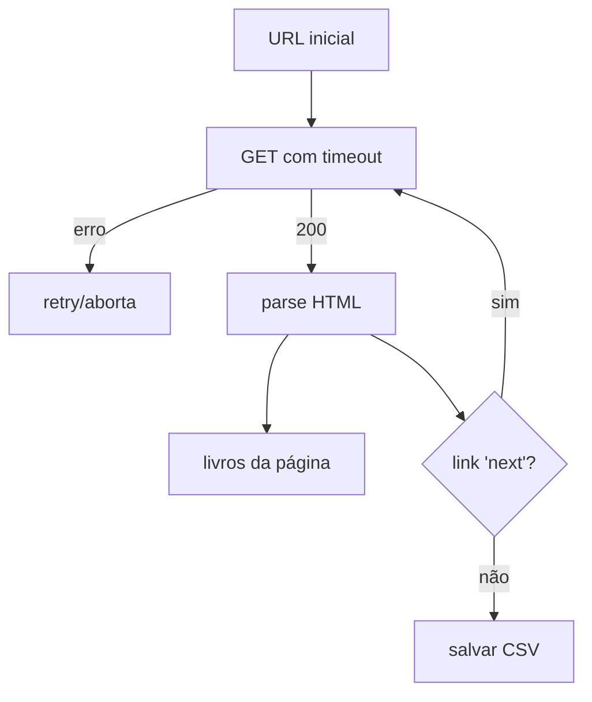

# 🕷️ Projeto 04 – Web Scraper Básico

> [!note] Pré-requisitos
> [[05 - Tratamento de Erros e Arquivos/01 - try except else finally|Tratamento de erros]], [[06 - Módulos da Biblioteca Padrão Essenciais/04 - re Expressões Regulares|regex]], [[03 - Funções e Modularização/05 - Virtual Environments e pip|venv e pip]].

## 🎯 Objetivo

Coletar título, preço e avaliação de todos os livros do site de treino **[books.toscrape.com](https://books.toscrape.com)** (criado justamente para praticar scraping) e salvar em CSV.

> [!warning] Ética e legalidade
> - Faça scraping **só de sites que permitem** (leia `robots.txt` e os termos de uso).
> - Use um intervalo entre requisições (`time.sleep`) para não sobrecarregar o servidor.
> - Identifique-se com um `User-Agent` honesto.
> - Prefira **APIs oficiais** quando existirem.

## ⚙️ Preparação

```bash
python -m venv .venv
source .venv/bin/activate        # Windows: .venv\Scripts\activate
pip install requests beautifulsoup4
```

## ✅ Requisitos

| # | Requisito |
|---|---|
| R1 | Baixar páginas com `requests` (timeout obrigatório) |
| R2 | Extrair com `BeautifulSoup`: título, preço, avaliação (1–5), disponibilidade |
| R3 | Seguir a paginação até acabar |
| R4 | Pausa de 0,5 s entre páginas e *retry* simples em falha de rede |
| R5 | Salvar `livros.csv` |
| R6 | A função de **parsing** deve ser testável **offline** (recebe HTML, devolve dados) |

## 🗺️ Fluxo



## 🪜 Passo a passo

1. **Inspecione o HTML** no navegador (F12). Cada livro está em `<article class="product_pod">`.
2. **Separe download de parsing:** `baixar(url) -> str` e `extrair(html) -> list[dict]`.
3. **Extração:**
   - título: `article.h3.a["title"]`
   - preço: `p.price_color` (texto `£51.77`)
   - avaliação: classe de `p.star-rating` (`star-rating Three`)
4. **Paginação:** `li.next a["href"]` + `urllib.parse.urljoin`.
5. **Salvar** com `csv.DictWriter`.

> [!tip] Seletores CSS
> `soup.select("article.product_pod")` é mais legível que encadear `find_all`.

> [!warning] ❌ Armadilhas
> - Sem `timeout`, `requests.get` pode **esperar para sempre**.
> - Links relativos (`catalogue/page-2.html`) precisam de `urljoin`.
> - O texto `£` pode aparecer corrompido se a codificação for mal detectada: use `resposta.encoding = "utf-8"`.
> - Sites mudam o HTML: seu scraper **vai quebrar** um dia. Mantenha o parsing isolado.

## 🏆 Desafios extras

1. Entrar na página de cada livro e coletar a descrição.
2. Baixar capas com `requests` em *streaming*.
3. Versão **assíncrona** com `httpx` + `asyncio` ([[08 - Avançado/02 - Asyncio|Asyncio]]) e comparar tempos.
4. Cache local de páginas para não baixar de novo.
5. Teste com `pytest` usando um HTML salvo em arquivo.

> [!success] Solução
> [[09 - Projetos Práticos/Projeto 04 - Solução|Projeto 04 – Solução]]

---

⬅️ [[09 - Projetos Práticos/Projeto 03 - Solução|Solução do Projeto 03]] | ➡️ [[09 - Projetos Práticos/Projeto 04 - Solução|Solução]]

#python #projeto #scraping #requests #beautifulsoup
