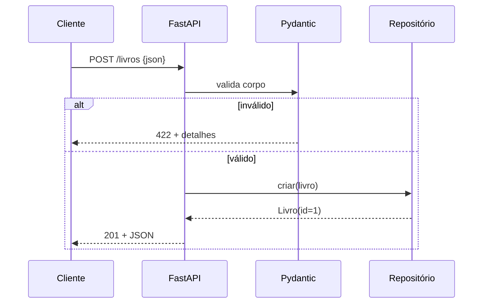

# 🌐 Projeto 05 – API REST com FastAPI

> [!note] Pré-requisitos
> [[07 - Programação Funcional e Intermediário/06 - Type Hints e typing|Type hints]] (o FastAPI vive deles), [[04 - Programação Orientada a Objetos/01 - Classes e Objetos|classes]] e [[03 - Funções e Modularização/05 - Virtual Environments e pip|venv]].

## 🎯 Objetivo

Construir uma API de **catálogo de livros** com CRUD completo, validação automática, documentação interativa (Swagger) e testes.

> [!tip] Por que FastAPI (e não Flask)?
> | | Flask | FastAPI |
> |---|---|---|
> | Validação | manual / extensões | **automática** via type hints (Pydantic) |
> | Docs OpenAPI | extensão | **embutida** (`/docs`) |
> | Async | limitado | nativo ([[08 - Avançado/02 - Asyncio|asyncio]]) |
> | Curva | muito suave | suave |
>
> Para Flask, o conceito é o mesmo: rotas + `request.get_json()` + validação manual.

## ⚙️ Preparação

```bash
python -m venv .venv && source .venv/bin/activate
pip install "fastapi[standard]" httpx pytest
fastapi dev main.py          # servidor com reload → http://127.0.0.1:8000/docs
```

## ✅ Requisitos

| # | Método e rota | Descrição | Status |
|---|---|---|---|
| R1 | `POST /livros` | cria livro | `201` |
| R2 | `GET /livros` | lista, com `?autor=`, `?skip=`, `?limit=` | `200` |
| R3 | `GET /livros/{id}` | detalhe | `200` / `404` |
| R4 | `PUT /livros/{id}` | substitui | `200` / `404` |
| R5 | `PATCH /livros/{id}` | atualiza campos enviados | `200` / `404` |
| R6 | `DELETE /livros/{id}` | remove | `204` / `404` |
| R7 | Validação: título/autor não vazios, ano entre 1450 e 2100 → `422` automático |
| R8 | Testes com `TestClient` |

## 🗺️ Fluxo de uma requisição



## 🪜 Passo a passo

1. **Modelos Pydantic:** `LivroIn` (entrada), `Livro(LivroIn)` com `id` (saída), `LivroPatch` (campos opcionais).
2. **Repositório em memória:** classe com `dict[int, Livro]` e contador de ids.
3. **Rotas** com `response_model` e `status_code` corretos.
4. **Erros:** `raise HTTPException(status_code=404, detail="...")`.
5. **PATCH:** `dados.model_dump(exclude_unset=True)` — só atualiza o que veio.
6. **Testes:** `TestClient(app)`.

> [!warning] ❌ Pegadinhas comuns
> - **Estado em memória** some ao reiniciar (e é separado por processo/worker). Para produção, use um banco.
> - `PUT` **substitui** o recurso inteiro; `PATCH` altera parcialmente. Não confunda.
> - Retornar `200` com `{"erro": ...}` em vez de usar o status HTTP certo.
> - Mutável como padrão: `def f(tags: list = [])` ([[03 - Funções e Modularização/02 - args kwargs e Argumentos Padrão|args e padrões]]).

### Códigos HTTP essenciais

| Código | Significado |
|---|---|
| `200` OK · `201` Created · `204` No Content | sucesso |
| `400` Bad Request · `404` Not Found · `409` Conflict · `422` Unprocessable | erro do cliente |
| `500` Internal Server Error | erro do servidor |

## 🏆 Desafios extras

1. Persistir em SQLite ([[09 - Projetos Práticos/Projeto 07 - Login com SQLite|Projeto 07]]).
2. Autenticação com chave de API (header `X-API-Key`) via `Depends`.
3. Paginação com resposta `{"total": ..., "itens": [...]}`.
4. Impedir livro duplicado (`409 Conflict`).
5. Versão Flask da mesma API, comparando o código.

> [!success] Solução
> [[09 - Projetos Práticos/Projeto 05 - Solução|Projeto 05 – Solução]]

---

⬅️ [[09 - Projetos Práticos/Projeto 04 - Solução|Solução do Projeto 04]] | ➡️ [[09 - Projetos Práticos/Projeto 05 - Solução|Solução]]

#python #projeto #api #rest #fastapi #pydantic
