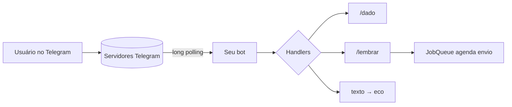

# 🤖 Projeto 06 – Bot de Telegram

> [!note] Pré-requisitos
> [[08 - Avançado/02 - Asyncio|Asyncio (`async/await`)]], [[05 - Tratamento de Erros e Arquivos/01 - try except else finally|tratamento de erros]] e variáveis de ambiente ([[06 - Módulos da Biblioteca Padrão Essenciais/01 - os pathlib e sys|os]]).

## 🎯 Objetivo

Criar um bot com comandos de utilidade (`/dado`, `/moeda`, `/lembrar`) usando a biblioteca **python-telegram-bot** (v21+, assíncrona).

> [!tip] E o Discord?
> A estrutura é a mesma: *token* + *handlers de eventos/comandos* + *loop assíncrono*. Veja os desafios para a versão com `discord.py`.

## ⚙️ Preparação

1. No Telegram, converse com **@BotFather** → `/newbot` → guarde o **token**.
2. Instale:
   ```bash
   pip install "python-telegram-bot[job-queue]"
   ```
3. Exporte o token (**nunca** coloque no código nem no Git):
   ```bash
   export TELEGRAM_TOKEN="123456:ABC..."        # Windows (PowerShell): $env:TELEGRAM_TOKEN="..."
   ```

> [!warning] Segredos
> Token vazado = qualquer pessoa controla seu bot. Use variáveis de ambiente ou `.env` (+ `.gitignore`). Se vazar, gere outro com `/revoke` no BotFather.

## ✅ Requisitos

| # | Requisito |
|---|---|
| R1 | `/start` e `/ajuda` com a lista de comandos |
| R2 | `/dado [lados]` rola um dado (padrão 6, máximo 1000) |
| R3 | `/moeda` cara ou coroa |
| R4 | `/lembrar <segundos> <texto>` envia o lembrete depois do tempo |
| R5 | Mensagens de texto comuns recebem eco |
| R6 | Lógica pura (dado, parsing) **separada** dos handlers → testável sem Telegram |
| R7 | Logging; token lido de `TELEGRAM_TOKEN` |

## 🗺️ Arquitetura



## 🪜 Passo a passo

1. **Funções puras** em `logica.py`: `rolar_dado(lados)`, `parse_lembrete(args)`.
2. **Handlers** `async def comando(update, context)` que chamam a lógica e respondem com `await update.message.reply_text(...)`.
3. **Registro:** `app.add_handler(CommandHandler("dado", dado))`.
4. **Lembretes:** `context.job_queue.run_once(callback, when=segundos, chat_id=..., data=texto)`.
5. **Executar:** `app.run_polling()`.

> [!warning] ❌ Pegadinhas
> - Esquecer o `await` → a resposta **nunca é enviada** (aparece apenas um aviso `coroutine was never awaited`).
> - Usar `time.sleep()` num handler **trava o bot inteiro**; use `JobQueue` ou `await asyncio.sleep()`.
> - `context.args` é lista de strings: valide e converta com `try/except ValueError`.
> - Dois processos com o mesmo token em polling → erro `Conflict`.

## 🏆 Desafios extras

1. Persistir lembretes em arquivo/SQLite para sobreviverem a reinícios.
2. Comando `/clima <cidade>` consumindo uma API pública (use `httpx.AsyncClient`).
3. Teclado inline (`InlineKeyboardMarkup`) para escolher o dado.
4. Versão **Discord** com `discord.py` (`@bot.command()`).
5. Restringir comandos a usuários autorizados (lista de IDs).
6. Deploy em um servidor/contêiner com `systemd` ou Docker.

> [!success] Solução
> [[09 - Projetos Práticos/Projeto 06 - Solução|Projeto 06 – Solução]]

---

⬅️ [[09 - Projetos Práticos/Projeto 05 - Solução|Solução do Projeto 05]] | ➡️ [[09 - Projetos Práticos/Projeto 06 - Solução|Solução]]

#python #projeto #bot #telegram #asyncio
