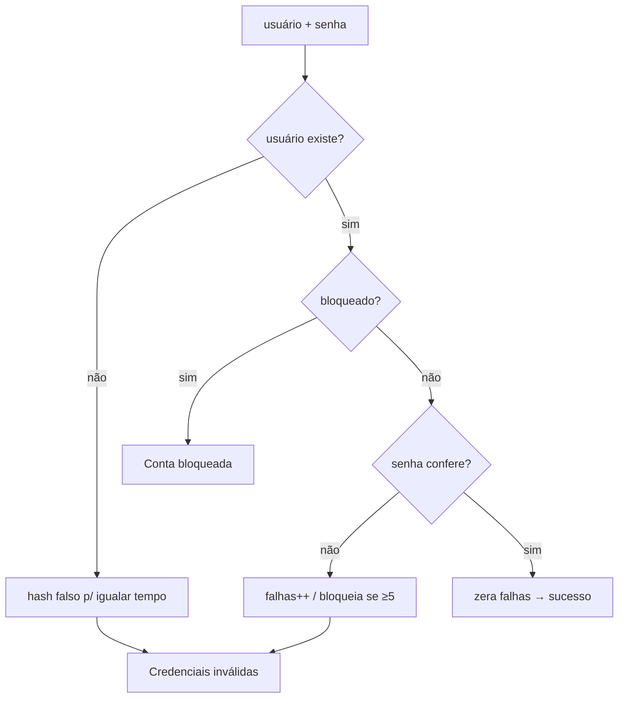

# 🔐 Projeto 07 – Sistema de Login com SQLite

> [!note] Pré-requisitos
> [[05 - Tratamento de Erros e Arquivos/02 - Exceções Personalizadas|Exceções personalizadas]], [[07 - Programação Funcional e Intermediário/05 - Context Managers Avançados|context managers]] e noções de SQL.

## 🎯 Objetivo

Criar o módulo de autenticação de um sistema: **cadastro**, **login** e **bloqueio contra força bruta**, armazenando usuários em **SQLite** com senhas protegidas por *hash + salt*.

> [!warning] Regra de ouro
> **Nunca** guarde senhas em texto puro — nem "criptografadas" de forma reversível. Guarde um **hash lento com salt** (scrypt, bcrypt, argon2). MD5/SHA-1/SHA-256 simples **não** servem para senhas (são rápidos demais).

## 📚 Mini-curso de SQLite em Python

```python
import sqlite3

conn = sqlite3.connect("app.db")          # cria o arquivo se não existir
conn.execute("CREATE TABLE IF NOT EXISTS t (id INTEGER PRIMARY KEY, nome TEXT)")
conn.execute("INSERT INTO t (nome) VALUES (?)", ("Ana",))   # ? = parâmetro seguro
conn.commit()
for linha in conn.execute("SELECT * FROM t"):
    print(linha)
conn.close()
```

### ❌ SQL Injection × ✅ consulta parametrizada

```python
usuario = "x' OR '1'='1"

# ❌ NUNCA: concatenar texto do usuário no SQL
conn.execute(f"SELECT * FROM usuarios WHERE usuario = '{usuario}'")   # retorna TODOS!

# ✅ SEMPRE: parâmetros
conn.execute("SELECT * FROM usuarios WHERE usuario = ?", (usuario,))
```

## ✅ Requisitos

| # | Requisito |
|---|---|
| R1 | Tabela `usuarios` (`id`, `usuario` único sem diferenciar maiúsculas, `senha_hash`, `criado_em`, `falhas`, `bloqueado_ate`) |
| R2 | Cadastro com validação: usuário `[A-Za-z0-9_]{3,20}`; senha ≥ 8 caracteres com letra e número |
| R3 | Senha armazenada como `scrypt$n$r$p$salt$hash` (salt aleatório por usuário) |
| R4 | Login com comparação em **tempo constante** (`hmac.compare_digest`) |
| R5 | Após 5 falhas seguidas, bloquear a conta por 5 minutos |
| R6 | Mensagem **genérica** para usuário/senha incorretos (não revelar qual errou) |
| R7 | Consultas **sempre parametrizadas** |
| R8 | Menu de terminal (`getpass` para digitar a senha sem eco) |

## 🗺️ Fluxo de login



## 🪜 Passo a passo

1. **Hash:** `hashlib.scrypt(senha, salt=os.urandom(16), n=2**14, r=8, p=1)`; guarde parâmetros junto do hash (permite evoluir depois).
2. **Verificação:** recalcule com o mesmo salt e compare com `hmac.compare_digest`.
3. **Esquema SQL** com `UNIQUE ... COLLATE NOCASE`; trate `sqlite3.IntegrityError` como "usuário já existe".
4. **Exceções:** `ErroAuth` → `UsuarioExistente`, `CredenciaisInvalidas`, `ContaBloqueada`, `SenhaFraca`.
5. **Bloqueio:** contador de falhas + `bloqueado_ate` (timestamp).
6. **Menu** com `getpass.getpass()`.

> [!tip] Por que mensagem genérica?
> Dizer "usuário não existe" ajuda atacantes a **enumerar** contas válidas. Responda sempre "usuário ou senha inválidos".

## 🏆 Desafios extras

1. Troca de senha (exigindo a senha atual).
2. Sessões/tokens com `secrets.token_urlsafe(32)` e expiração.
3. Reaproveitar o módulo na API do [[09 - Projetos Práticos/Projeto 05 - API REST|Projeto 05]].
4. Migrar para `argon2-cffi` ou `bcrypt` (bibliotecas externas, padrão da indústria).
5. Log de auditoria (tabela de tentativas de login).
6. Testes com `pytest` e banco `:memory:`.

> [!success] Solução
> [[09 - Projetos Práticos/Projeto 07 - Solução|Projeto 07 – Solução]]

---

⬅️ [[09 - Projetos Práticos/Projeto 06 - Solução|Solução do Projeto 06]] | ➡️ [[09 - Projetos Práticos/Projeto 07 - Solução|Solução]]

#python #projeto #sqlite #seguranca #hash #login
