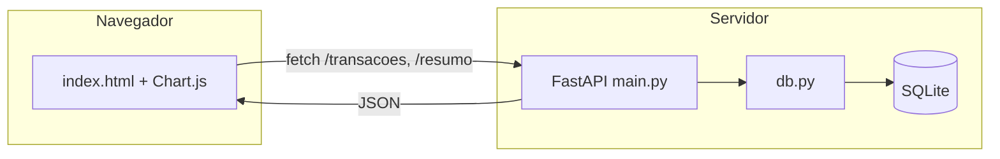
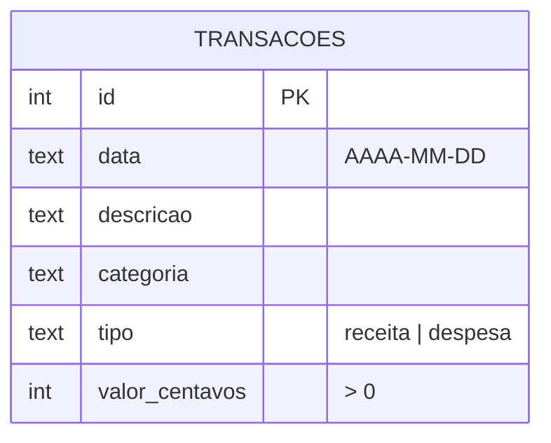

# 🏁 Projeto 08 – Projeto Final: Dashboard de Finanças Pessoais

> [!note] Pré-requisitos
> Praticamente tudo: [[08 - Avançado/06 - Testes com unittest e pytest|testes]], [[07 - Programação Funcional e Intermediário/06 - Type Hints e typing|type hints]], [[07 - Programação Funcional e Intermediário/05 - Context Managers Avançados|context managers]], [[09 - Projetos Práticos/Projeto 05 - API REST|API REST]] e [[09 - Projetos Práticos/Projeto 07 - Login com SQLite|SQLite]].

## 🎯 Objetivo

Uma aplicação **full-stack simples**: backend **FastAPI** + banco **SQLite** + página **HTML/JS** com formulário, tabela e gráfico por categoria — para controlar receitas e despesas mensais.



## ✅ Requisitos

| # | Requisito |
|---|---|
| R1 | `POST /transacoes` cria receita/despesa (data, descrição, categoria, valor) |
| R2 | `GET /transacoes?mes=AAAA-MM` lista; `DELETE /transacoes/{id}` remove |
| R3 | `GET /resumo?mes=AAAA-MM` → receitas, despesas, saldo e total **por categoria** |
| R4 | **Valores em centavos** (inteiros) no banco — nada de `float` para dinheiro |
| R5 | Página `/` com formulário, tabela e gráfico (Chart.js) |
| R6 | Camada `db.py` separada, com *context manager* de conexão e transação |
| R7 | Testes da camada de dados com banco temporário |
| R8 | Validação de entrada (valor > 0, tipo `receita`/`despesa`, mês no formato correto) |

## 🗺️ Modelo de dados



## 🪜 Passo a passo (sugerido)

1. **Esquema SQL** com `CHECK` (garante integridade mesmo se a API tiver bug).
2. **`db.py`**: `conectar()` (context manager), `iniciar()`, `adicionar()`, `listar()`, `remover()`, `resumo()`.
3. **Testes de `db.py`** primeiro (TDD leve).
4. **`main.py`**: modelos Pydantic + rotas; `lifespan` para criar as tabelas na inicialização.
5. **Conversão R$ ⇄ centavos** nas bordas (entrada/saída da API).
6. **`static/index.html`**: `fetch` + Chart.js.
7. **Polimento**: mensagens de erro, README, `pyproject.toml` ([[08 - Avançado/07 - Packaging e Distribuição|Packaging]]).

> [!tip] Por que centavos?
> ```python
> >>> 0.1 + 0.2
> 0.30000000000000004     # ❌ erros de arredondamento acumulam
> >>> 10 + 20             # ✅ 10 centavos + 20 centavos = 30 (inteiros são exatos)
> 30
> ```

> [!warning] ❌ Pegadinhas
> - `sqlite3` + FastAPI com **uma conexão global** compartilhada entre threads dá erro (`check_same_thread`). Solução adotada: **uma conexão por requisição**.
> - Servir HTML com `open()` relativo ao diretório *atual* quebra se você rodar de outra pasta; use `Path(__file__).parent`.
> - Filtrar mês com `LIKE '2026-10%'` funciona, mas `substr(data,1,7) = ?` é mais explícito e parametrizável.
> - Inserir texto do usuário no HTML via `innerHTML` abre **XSS**; use `textContent`.

## 🏆 Desafios extras

1. **Login** reaproveitando o [[09 - Projetos Práticos/Projeto 07 - Login com SQLite|Projeto 07]]: cada usuário vê só suas transações.
2. Importar extrato bancário em **CSV** ([[09 - Projetos Práticos/Projeto 03 - Análise de Dados com CSV|Projeto 03]]).
3. Orçamento mensal por categoria com alerta ao ultrapassar.
4. Gráfico de evolução mensal (linha).
5. **Docker** + `docker compose`; deploy gratuito (Render/Fly.io).
6. Trocar SQLite por PostgreSQL com SQLAlchemy.
7. Cobertura de testes ≥ 90 % (`pytest --cov`).

> [!success] Solução
> [[09 - Projetos Práticos/Projeto 08 - Solução|Projeto 08 – Solução]]

---

⬅️ [[09 - Projetos Práticos/Projeto 07 - Solução|Solução do Projeto 07]] | ➡️ [[09 - Projetos Práticos/Projeto 08 - Solução|Solução]]

#python #projeto #projeto-final #fastapi #sqlite #dashboard
