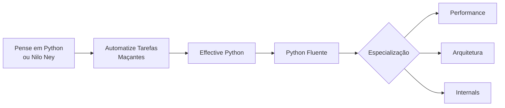

# 📚 Livros Recomendados

> [!note] Como usar esta lista
> Os livros estão agrupados por **momento da jornada**, alinhados aos módulos do vault. Edições e preços mudam: confira a edição mais recente antes de comprar. Quando há versão gratuita oficial dos autores, está indicado.

## 🟢 Para começar (Módulos 01–03)

| Livro | Autor | Por que ler | Idioma |
|---|---|---|---|
| **Pense em Python** (*Think Python*) | Allen B. Downey | Ensina a *pensar como programador*; versão em inglês gratuita online | pt-BR / en |
| **Automatize Tarefas Maçantes com Python** (*Automate the Boring Stuff*) | Al Sweigart | Projetos práticos (planilhas, PDFs, arquivos, web); versão em inglês gratuita online | pt-BR / en |
| **Introdução à Programação com Python** | Nilo Ney Coutinho | Muito usado em português; ótimo para quem está começando do zero | pt-BR |
| **Python Crash Course** | Eric Matthes | Revisão rápida + 3 projetos (jogo, visualização de dados, app web) | en (há tradução) |

Relacionados: [[01 - Fundamentos/01 - Instalação e Ambiente|Instalação]], [[01 - Fundamentos/07 - Exercícios de Fundamentos|Exercícios de Fundamentos]].

## 🟡 Intermediário (Módulos 04–07)

| Livro | Autor | Por que ler |
|---|---|---|
| **Python Fluente** (*Fluent Python*, 2ª ed.) | Luciano Ramalho | A referência sobre o "jeito Python": modelo de dados, generators, decorators, tipos, asyncio. Brasileiro, com edição em português |
| **Effective Python** | Brett Slatkin | Dezenas de boas práticas curtas e objetivas |
| **Python Cookbook** | David Beazley & Brian K. Jones | Receitas para problemas reais |
| **Python Tricks** | Dan Bader | Idiomas e "pulos do gato" em formato leve |

Relacionados: [[04 - Programação Orientada a Objetos/01 - Classes e Objetos|POO]], [[07 - Programação Funcional e Intermediário/03 - Decorators|Decorators]], [[07 - Programação Funcional e Intermediário/04 - Generators e Iterators|Generators]].

## 🔴 Avançado (Módulo 08)

| Livro | Autor | Tema |
|---|---|---|
| **Fluent Python** (partes finais) | Ramalho | metaprogramação, concorrência |
| **High Performance Python** | Micha Gorelick & Ian Ozsvald | profiling e otimização |
| **CPython Internals** | Anthony Shaw | como o interpretador funciona |
| **Architecture Patterns with Python** | Harry Percival & Bob Gregory | arquitetura limpa, DDD, TDD (gratuito online) |
| **Test-Driven Development with Python** | Harry Percival | TDD com Django e Selenium (gratuito online) |
| **Robust Python** | Patrick Viafore | tipos e código manutenível |
| **Using Asyncio in Python** | Caleb Hattingh | aprofundamento em `asyncio` |

Relacionados: [[08 - Avançado/01 - Metaprogramação|Metaprogramação]], [[08 - Avançado/04 - CPython Internals|CPython Internals]], [[08 - Avançado/05 - Performance e Profiling|Performance]], [[08 - Avançado/06 - Testes com unittest e pytest|Testes]].

## 🧱 Engenharia de software em geral

| Livro | Autor | Por que ler |
|---|---|---|
| **Código Limpo** (*Clean Code*) | Robert C. Martin | Nomes, funções, comentários (exemplos em Java; princípios valem para Python) |
| **Refatoração** (*Refactoring*) | Martin Fowler | Catálogo de refatorações |
| **O Programador Pragmático** | Hunt & Thomas | Mentalidade e hábitos |
| **Padrões de Projeto** (*Design Patterns*) | Gamma et al. | Base dos patterns — veja [[08 - Avançado/08 - Design Patterns Avançados e Clean Code|Design Patterns]] |

## 🗺️ Trilha de leitura sugerida

> [!tip] Dica de estudo
> Livro lido sem código escrito rende pouco. A cada capítulo: **digite** os exemplos no REPL, **quebre** de propósito, e anote dúvidas neste vault (use [[Glossário#Python|o glossário]] como ponto de partida).

---

⬅️ [[09 - Projetos Práticos/Projeto 08 - Solução|Solução do Projeto 08]] | ➡️ [[10 - Recursos e Referências/02 - Sites e Documentação Oficial|Sites e Documentação Oficial]]

#python #recursos #livros #leitura
