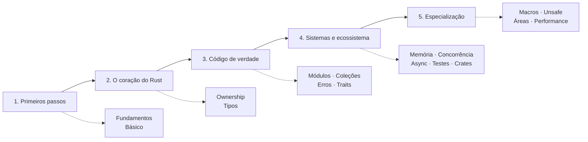
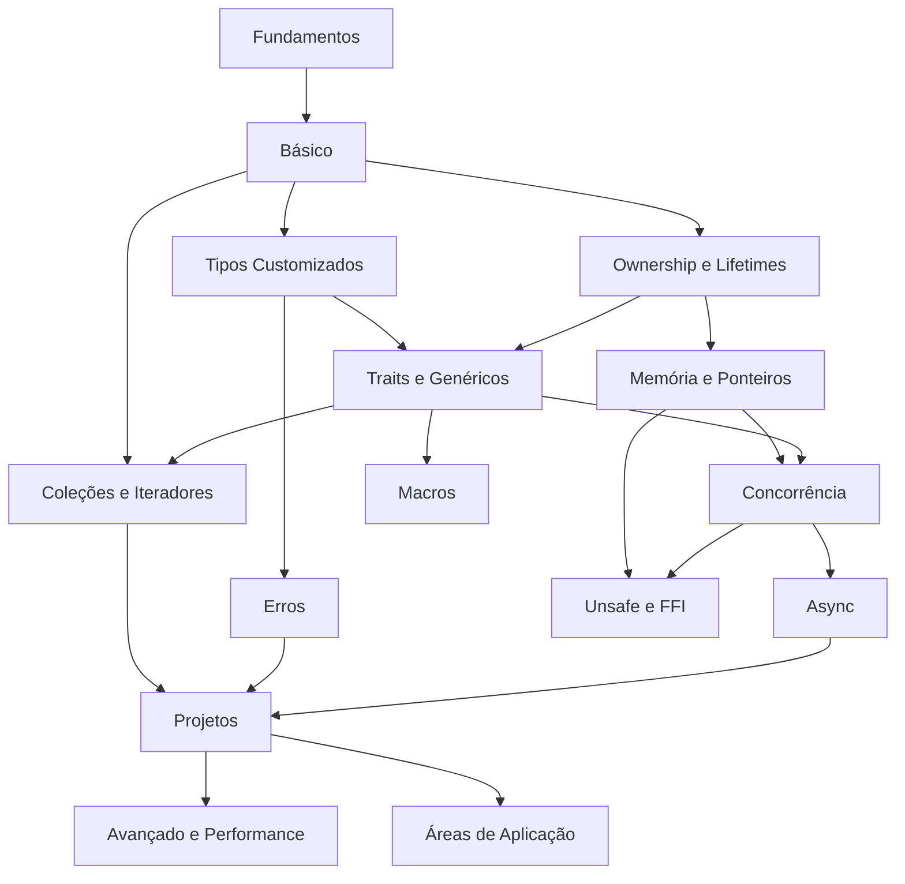

# Home - Rust

> [!abstract] Rust — Material de Estudos
> Do zero ao avançado, em português do Brasil. **Rust 1.99 · edição 2024.** mais de 250 notas, centenas de exemplos testados, 8 projetos guiados, exercícios com gabarito e flashcards.

## Comece por aqui

1. Leia [[Como usar este vault - Rust]].
2. Siga a [[Trilha de estudos - Rust]] (ou o [[Roteiro por semanas]], um plano de 12 semanas).
3. Consulte o [[Índice geral - Rust]] quando quiser achar algo específico.

## Trilha de estudos

| Etapa | MOCs |
|---|---|
| 1. Primeiros passos | [[MOC - Fundamentos - Rust]], [[MOC - Básico da Linguagem]] |
| 2. O coração do Rust | [[MOC - Ownership e Lifetimes]], [[MOC - Tipos Customizados]] |
| 3. Código de verdade | [[MOC - Módulos e Cargo]], [[MOC - Coleções e Iteradores]], [[MOC - Erros]], [[MOC - Traits e Genéricos]] |
| 4. Sistemas e ecossistema | [[MOC - Memória e Ponteiros]], [[MOC - Concorrência]], [[MOC - Async]], [[MOC - Testes e Qualidade]], [[MOC - Crates]] |
| 5. Especialização | [[MOC - Macros]], [[MOC - Unsafe e FFI]], [[MOC - Áreas de Aplicação]], [[MOC - Avançado e Performance]] |
| Prática e apoio | [[MOC - Projetos - Rust]], [[MOC - Exercícios - Rust]], [[MOC - Referência - Rust]], [[MOC - Checklists e Roteiros]], [[MOC - Templates]] |

Mapa visual: [[Trilha de Aprendizado em Rust.canvas]].

## Todos os MOCs

| Pasta | MOC | Conteúdo |
|---|---|---|
| 01 - Fundamentos | [[MOC - Fundamentos - Rust]] | O que é Rust, filosofia, instalação, Cargo e o pipeline de compilação |
| 02 - Básico da Linguagem | [[MOC - Básico da Linguagem]] | Variáveis, tipos, funções, controle de fluxo, strings e formatação |
| 03 - Ownership e Lifetimes | [[MOC - Ownership e Lifetimes]] | Ownership, borrowing, borrow checker e lifetimes |
| 04 - Tipos Customizados | [[MOC - Tipos Customizados]] | Structs, enums, Option, Result e pattern matching |
| 05 - Módulos e Cargo | [[MOC - Módulos e Cargo]] | Módulos, visibilidade, workspaces, features e publicação |
| 06 - Coleções e Iteradores | [[MOC - Coleções e Iteradores]] | Vec, HashMap, iteradores, closures e ordenação |
| 07 - Erros | [[MOC - Erros]] | Panic, Result, operador ?, erros customizados, thiserror e anyhow |
| 08 - Traits e Genéricos | [[MOC - Traits e Genéricos]] | Genéricos, traits, dyn, traits padrão e operadores |
| 09 - Memória e Ponteiros | [[MOC - Memória e Ponteiros]] | Stack e heap, Box, Rc, Arc, RefCell, Weak e Drop |
| 10 - Concorrência | [[MOC - Concorrência]] | Threads, canais, Mutex, atômicos, Send/Sync e Rayon |
| 11 - Async | [[MOC - Async]] | async/await, Future, Pin, Tokio e armadilhas |
| 12 - Testes e Qualidade | [[MOC - Testes e Qualidade]] | Testes, doc tests, proptest, criterion, Clippy e CI |
| 13 - Crates | [[MOC - Crates]] | serde, clap, reqwest, axum, sqlx, tracing e outros |
| 14 - Macros | [[MOC - Macros]] | macro_rules, macros procedurais, syn e quote |
| 15 - Unsafe e FFI | [[MOC - Unsafe e FFI]] | unsafe, ponteiros crus, FFI com C/C++/Python e Miri |
| 16 - Áreas de Aplicação | [[MOC - Áreas de Aplicação]] | CLI, web, WebAssembly, embarcados, jogos, dados e infraestrutura |
| 17 - Avançado e Performance | [[MOC - Avançado e Performance]] | Typestate, builder, GATs, perfilamento e otimização |
| 18 - Projetos | [[MOC - Projetos - Rust]] | 8 projetos guiados completos |
| 19 - Referência | [[MOC - Referência - Rust]] | Glossário, cheat sheets, erros do compilador e FAQ |
| 20 - Exercícios | [[MOC - Exercícios - Rust]] | Listas com gabarito e flashcards |
| Checklists e roteiros | [[MOC - Checklists e Roteiros]] | Roteiro semanal e checklists (os canvases estão em [[MOC - Anexos]]) |
| Templates | [[MOC - Templates]] | Modelos de nota |

## Atalhos úteis

| Quero... | Vá para |
|---|---|
| Entender ownership de uma vez | [[Cheat sheet de ownership]] e [[Mapa do Ownership.canvas]] |
| Decifrar um erro do compilador | [[Tabela de erros do compilador]] |
| Escolher uma coleção | [[Escolhendo uma coleção]] |
| Escolher um ponteiro inteligente | [[Escolhendo ponteiro inteligente]] |
| Escolher entre async e threads | [[Async vs threads]] |
| Comandos do Cargo | [[Cheat sheet de Cargo]] |
| Lembrar da sintaxe | [[Cheat sheet de sintaxe]] |
| Vir de outra linguagem | [[Conceitos equivalentes em outras linguagens]] |
| Tirar dúvidas | [[FAQ - Rust]] e [[Erros comuns de iniciantes]] |
| Aprender fazendo | [[Projeto 1 - Jogo de adivinhação]] |
| Revisar | [[Flashcards de fundamentos e ownership]] |
| Medir meu progresso | [[Checklist de progresso]] |
| Continuar estudando | [[Livros, cursos e comunidades]] |

## Mapa de dependências entre temas

> [!tip] Ordem não é lei
> O mapa mostra dependências naturais, mas você pode pular para um projeto ou área de interesse e voltar às notas quando precisar.

## Convenções

- Exemplos de código Rust compilam na edição 2024, exceto os marcados com `// ❌ NÃO COMPILA` (erro proposital, com mensagem e correção), `// trecho` ou `// requer crate`.
- Callouts `> [!question] Verificar na documentação oficial` indicam pontos sujeitos a mudança.
- Níveis: `iniciante`, `intermediario`, `avancado` (campo `nivel` do frontmatter).

## Veja também

- [[Trilha de estudos - Rust]]
- [[Índice geral - Rust]]
- [[Como usar este vault - Rust]]
- [[MOC - Início - Rust]]
- [[MOC - Fundamentos - Rust]]
- [[MOC - Básico da Linguagem]]
- [[MOC - Ownership e Lifetimes]]
- [[MOC - Tipos Customizados]]
- [[MOC - Módulos e Cargo]]
- [[MOC - Coleções e Iteradores]]
- [[MOC - Erros]]
- [[MOC - Traits e Genéricos]]
- [[MOC - Memória e Ponteiros]]
- [[MOC - Concorrência]]
- [[MOC - Async]]
- [[MOC - Testes e Qualidade]]
- [[MOC - Crates]]
- [[MOC - Macros]]
- [[MOC - Unsafe e FFI]]
- [[MOC - Áreas de Aplicação]]
- [[MOC - Avançado e Performance]]
- [[MOC - Projetos - Rust]]
- [[MOC - Referência - Rust]]
- [[MOC - Exercícios - Rust]]
- [[MOC - Checklists e Roteiros]]
- [[MOC - Templates]]
