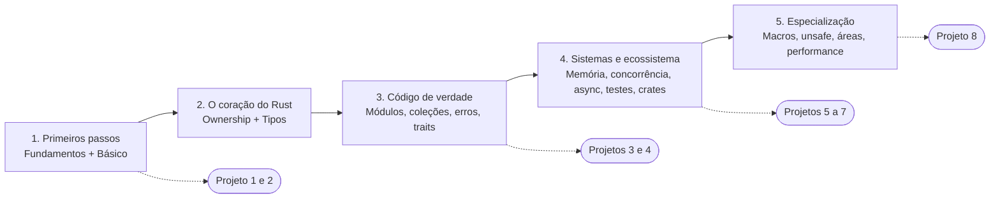

# Trilha de aprendizado - Rust

A trilha tem **cinco etapas**. Cada etapa termina com um marco prático: só avance quando conseguir cumpri-lo sem consultar o gabarito.

## Etapa 1 — Primeiros passos (≈ 2 a 3 semanas)

- [[MOC - Fundamentos - Rust]]: o que é Rust, instalação, Cargo básico.
- [[MOC - Básico da Linguagem]]: variáveis, tipos, funções, controle de fluxo, strings.
- **Marco:** [[Projeto 1 - Jogo de adivinhação]] e [[Exercícios de fundamentos]].

## Etapa 2 — O coração do Rust (≈ 2 a 3 semanas)

- [[MOC - Ownership e Lifetimes]]: ownership, borrowing, lifetimes.
- [[MOC - Tipos Customizados]]: structs, enums, `Option`, `Result`, pattern matching.
- **Marco:** [[Exercícios de ownership]], [[Exercícios de tipos e pattern matching]] e [[Projeto 2 - CLI de tarefas]].

> [!tip] Se travar aqui, é normal
> Releia [[Cheat sheet de ownership]] e [[Erros comuns do borrow checker]]. Quase todo mundo precisa passar pelo borrow checker algumas vezes antes de ele "clicar".

## Etapa 3 — Código de verdade (≈ 3 semanas)

- [[MOC - Módulos e Cargo]], [[MOC - Coleções e Iteradores]], [[MOC - Erros]], [[MOC - Traits e Genéricos]].
- **Marco:** [[Exercícios de coleções e iteradores]], [[Exercícios de erros, traits e genéricos]], [[Projeto 3 - Minigrep]] e [[Projeto 4 - Calculadora com parser]].

## Etapa 4 — Sistemas e ecossistema (≈ 3 a 4 semanas)

- [[MOC - Memória e Ponteiros]], [[MOC - Concorrência]], [[MOC - Async]].
- [[MOC - Testes e Qualidade]], [[MOC - Crates]].
- **Marco:** [[Exercícios de concorrência]], [[Projeto 5 - Servidor HTTP com thread pool]], [[Projeto 6 - API REST com banco de dados]] e [[Projeto 7 - Chat assíncrono com Tokio]].

## Etapa 5 — Especialização (contínua)

- [[MOC - Macros]], [[MOC - Unsafe e FFI]], [[MOC - Áreas de Aplicação]], [[MOC - Avançado e Performance]].
- **Marco:** [[Projeto 8 - Interpretador simples]] e um projeto próprio em uma área à sua escolha.

## Em paralelo, o tempo todo

| Hábito | Onde |
|---|---|
| Consultar | [[MOC - Referência - Rust]] |
| Revisar | [[Flashcards de fundamentos e ownership]], [[Flashcards de traits, erros e concorrência]], [[Flashcards de Cargo, async e avançado]] |
| Marcar progresso | [[Checklist de progresso]] |
| Ler mais | [[Livros, cursos e comunidades]] |

Visão gráfica: [[Trilha de Aprendizado em Rust.canvas]].

## Veja também

- [[Roteiro por semanas]]
- [[Checklist de progresso]]
- [[Trilha de Aprendizado em Rust.canvas]]
- [[Livros, cursos e comunidades]]
