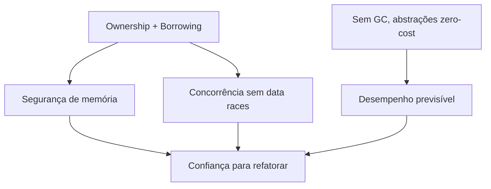

# Filosofia do Rust

A filosofia do Rust se apoia em três pilares que, normalmente, parecem conflitar em outras linguagens.

## 1. Segurança

O compilador rejeita programas com classes inteiras de bugs: acesso a memória liberada, *double free*, referências pendentes (dangling) e *data races*. O mecanismo central é o [[Ownership e regras|sistema de ownership]] com o *borrow checker*.

## 2. Desempenho

Não há coletor de lixo nem runtime pesado. Abstrações como iteradores são **zero-cost**: você não paga em tempo de execução pelo que não usa, e o que usa não conseguiria escrever melhor à mão.

## 3. Concorrência sem medo

Os mesmos mecanismos que garantem segurança de memória evitam *data races* em tempo de compilação, via traits `Send` e `Sync`.

> [!info] Erros em tempo de compilação
> Rust troca "bugs misteriosos em produção" por "mensagens de erro do compilador durante o desenvolvimento". A curva de aprendizado inicial é o preço.

## Princípios secundários

- **Explícito é melhor que implícito**: conversões numéricas, mutabilidade e tratamento de erros são visíveis no código.
- **Erros são valores**: `Result` e `Option` em vez de exceções e `null`.
- **Compatibilidade**: o código escrito para a versão 1.0 continua compilando; mudanças incompatíveis ficam em [[Edições do Rust]].

## Veja também

- [[O que é Rust]]
- [[Rust vs C, C++, Go, Python e Java]]
- [[Ownership e regras]]
