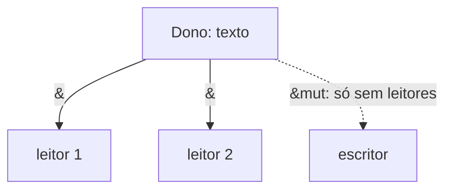

# Borrowing e referências

**Emprestar** é criar uma referência a um valor sem tomar o ownership. Referências são ponteiros sempre válidos.

```rust
fn tamanho(s: &String) -> usize {
    s.len()
} // s é só uma referência: nada é liberado aqui

fn adiciona_exclamacao(s: &mut String) {
    s.push('!');
}

fn main() {
    let mut texto = String::from("olá");

    let n = tamanho(&texto);       // referência compartilhada (imutável)
    println!("{texto} tem {n} bytes");

    adiciona_exclamacao(&mut texto); // referência exclusiva (mutável)
    println!("{texto}");
}
```

| Tipo | Sintaxe | Quantas ao mesmo tempo |
|---|---|---|
| Compartilhada | `&T` | Quantas quiser |
| Exclusiva | `&mut T` | **Uma**, e nenhuma `&T` junto |



## Desreferência

```rust
fn main() {
    let mut x = 10;
    let r = &mut x;
    *r += 5;         // * acessa o valor apontado
    println!("{x}"); // 15
}
```

> [!tip] Auto-deref
> Chamadas de método (`r.len()`) desreferenciam automaticamente; você raramente precisa de `*` com métodos.

> [!info] Sem referências nulas
> `&T` nunca é nula nem pendente. Para "talvez nada", use [[Option e Result|Option]].

## Veja também

- [[Regras do borrow checker]]
- [[Ownership e regras]]
- [[Slices]]
