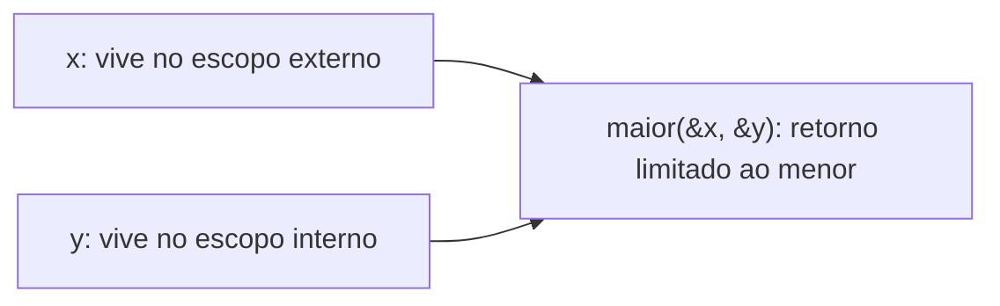

# Lifetimes

Um **lifetime** é a região do código em que uma referência é válida. Na maior parte do tempo o compilador os **infere**; você só os escreve quando há ambiguidade.

## O problema

```rust
// ❌ NÃO COMPILA: lifetime não especificado
fn maior(a: &str, b: &str) -> &str {
    if a.len() > b.len() { a } else { b }
}
```

```text
error[E0106]: missing lifetime specifier
```

O compilador não sabe se o retorno vem de `a` ou de `b`, portanto não sabe por quanto tempo é válido.

## A solução: anotar

```rust
// 'a diz: o retorno vive tão pouco quanto o menor dos dois argumentos
fn maior<'a>(a: &'a str, b: &'a str) -> &'a str {
    if a.len() > b.len() { a } else { b }
}

fn main() {
    let x = String::from("longa demais");
    let resultado;
    {
        let y = String::from("curta");
        resultado = maior(&x, &y);
        println!("{resultado}"); // usado dentro do escopo de y
    }
}
```

> [!info] Anotação não estende vida
> `'a` **descreve** relações entre vidas existentes; não faz nenhum dado viver mais.

## Referência pendente

```rust
// ❌ NÃO COMPILA: retorna referência a variável local
fn cria() -> &'static str {
    let s = String::from("oi");
    &s
}
```

```text
error[E0515]: cannot return reference to local variable `s`
```

**Correção:** devolver o valor (`String`) em vez de referência.



## Múltiplos lifetimes

```rust
fn primeiro<'a, 'b>(a: &'a str, _b: &'b str) -> &'a str {
    a // o retorno depende só de a
}

fn main() {
    println!("{}", primeiro("um", "dois"));
}
```

## Exercício

Escreva `fn mais_curta<'a>(a: &'a str, b: &'a str) -> &'a str` e teste com strings de comprimentos diferentes.

## Veja também

- [[Elisão de lifetimes]]
- [[Lifetimes em structs]]
- [[Lifetime static]]
- [[Regras do borrow checker]]
