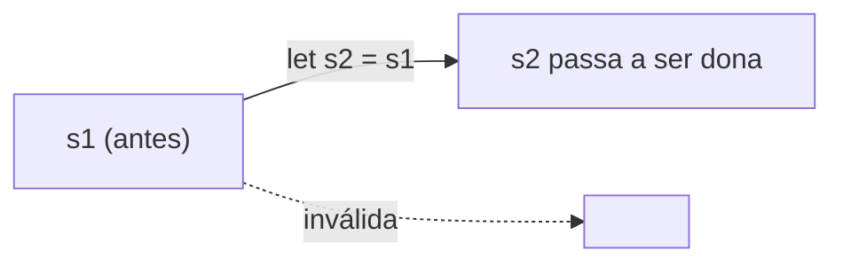

# Move, Copy e Clone

## Move

Atribuir ou passar um valor que gerencia recursos **move** o ownership; o original fica inválido.

```rust
// ❌ NÃO COMPILA: uso após move
fn main() {
    let s1 = String::from("oi");
    let s2 = s1;         // s1 foi movida para s2
    println!("{s1} {s2}");
}
```

```text
error[E0382]: borrow of moved value: `s1`
```

**Correção:** clonar (`s1.clone()`) ou emprestar (`&s1`).



## Clone

Cópia **profunda explícita** (pode ser cara).

```rust
fn main() {
    let s1 = String::from("oi");
    let s2 = s1.clone();
    println!("{s1} {s2}");
}
```

## Copy

Tipos simples que vivem só na pilha implementam `Copy` e são copiados bit a bit em atribuições, sem invalidar o original.

```rust
fn main() {
    let a = 5;
    let b = a; // cópia
    println!("{a} {b}");

    let p = (1, 2.5);   // tupla de Copy é Copy
    let q = p;
    println!("{:?} {:?}", p, q);
}
```

| Tipo | `Copy`? |
|---|---|
| inteiros, floats, `bool`, `char` | Sim |
| `&T` (referência compartilhada) | Sim |
| `&mut T` | Não |
| `String`, `Vec<T>`, `Box<T>` | Não |
| Tupla/array de `Copy` | Sim |

## Derivando para tipos próprios

```rust
#[derive(Debug, Clone, Copy)]
struct Ponto {
    x: i32,
    y: i32,
}

fn main() {
    let a = Ponto { x: 1, y: 2 };
    let b = a; // copiado
    println!("{:?} {:?}", a, b);
}
```

> [!warning] `Copy` e `Drop` são incompatíveis
> Um tipo que implementa `Drop` não pode ser `Copy`.

## Exercício

Crie uma struct `Usuario { nome: String, idade: u8 }`. Tente derivar `Copy` e leia o erro; depois derive apenas `Clone`.

## Veja também

- [[Ownership e regras]]
- [[Borrowing e referências]]
- [[Traits padrão]]
