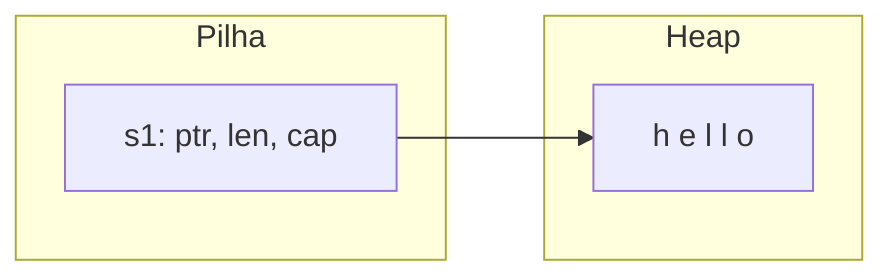

# Ownership e regras

**Ownership** é o conjunto de regras com que Rust gerencia memória sem GC. Ele é verificado em compilação e não tem custo em tempo de execução.

## As três regras

1. Cada valor tem exatamente **um dono** (variável).
2. Só pode haver **um dono por vez**.
3. Quando o dono sai de escopo, o valor é **descartado** (`drop`) e a memória liberada.

```rust
fn main() {
    {
        let s = String::from("olá"); // s é dona da String
        println!("{s}");
    } // s sai de escopo aqui: a memória é liberada automaticamente (Drop)

    // Passar para função transfere o ownership
    let a = String::from("texto");
    consome(a);
    // println!("{a}"); // erro: a foi movida (ver nota de Move)
}

fn consome(s: String) {
    println!("recebi {s}");
} // s é descartada aqui
```

## Stack e heap

| | Pilha (stack) | Heap |
|---|---|---|
| Tamanho | Conhecido em compilação | Dinâmico |
| Acesso | Muito rápido | Via ponteiro |
| Exemplos | `i32`, `bool`, arrays fixos | conteúdo de `String`, `Vec`, `Box` |

Uma `String` guarda na pilha um trio (ponteiro, tamanho, capacidade) e os bytes na heap. O ownership decide **quem libera** a heap.



> [!tip] RAII
> Liberar recursos ao sair de escopo vale para arquivos, sockets e locks, não só memória. Veja [[Drop e RAII]].

> [!info] Por que isso importa
> Sem GC e sem `free` manual, não há *double free* nem *use-after-free* em código seguro.

## Exercício

Escreva uma função que recebe uma `String`, imprime o comprimento e a devolve ao chamador (devolver o ownership).

## Veja também

- [[Move, Copy e Clone]]
- [[Borrowing e referências]]
- [[Regras do borrow checker]]
- [[Filosofia do Rust]]
