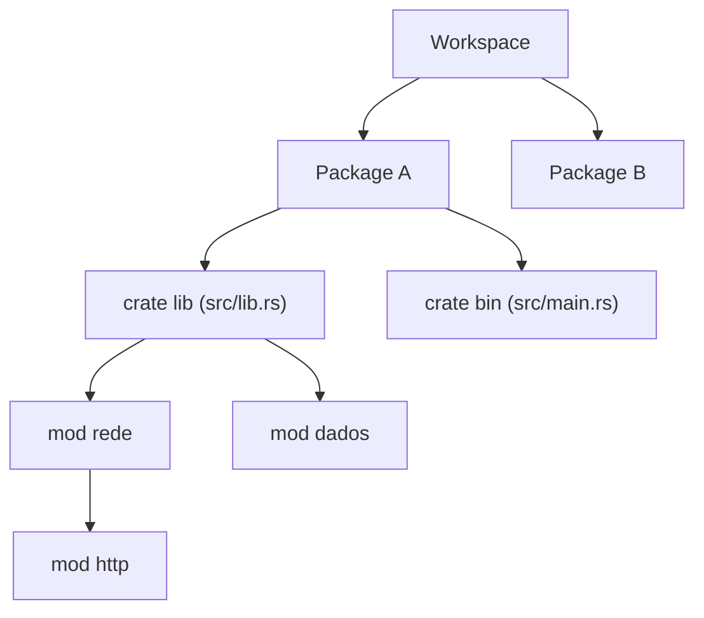

# Packages, crates e módulos

O sistema de módulos tem quatro conceitos, do maior para o menor:

| Conceito | O que é |
|---|---|
| **Workspace** | Conjunto de packages que compartilham `Cargo.lock` e `target/` |
| **Package** | O que o Cargo constrói/testa/publica; tem um `Cargo.toml` |
| **Crate** | Unidade de compilação: binário (`main.rs`) ou biblioteca (`lib.rs`) |
| **Módulo** | Namespace dentro de um crate, controla organização e privacidade |

- Um package pode ter **no máximo uma** crate de biblioteca e **várias** binárias (`src/bin/*.rs`).
- A raiz do crate é `src/main.rs` (binário) ou `src/lib.rs` (biblioteca); ela forma o módulo implícito `crate`.

> [!info] Crate vs package
> Na conversa do dia a dia, "crate" costuma significar "biblioteca publicada no crates.io", embora tecnicamente o termo seja a unidade de compilação.

## Veja também

- [[Módulos e mod]]
- [[Estrutura de projetos binário e biblioteca]]
- [[Workspaces - Rust]]
- [[Cargo básico]]
