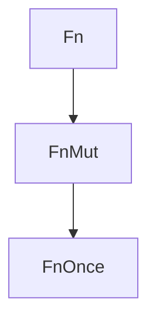

# Fn, FnMut e FnOnce

O compilador implementa automaticamente uma das três traits para cada closure, conforme o que ela faz com o que captura:

| Trait | A closure... | Pode ser chamada |
|---|---|---|
| `FnOnce` | **consome** valores capturados | uma vez |
| `FnMut` | **altera** valores capturados | várias vezes (precisa de `&mut`) |
| `Fn` | só **lê** (ou não captura) | várias vezes, inclusive em paralelo |



Toda `Fn` também é `FnMut` e `FnOnce`. Por isso, ao **receber** closures, peça o requisito mais fraco que satisfaça sua função.

```rust
fn aplica<F: Fn(i32) -> i32>(f: F, x: i32) -> i32 {
    f(x)
}

fn repete_duas<F: FnMut()>(mut f: F) {
    f();
    f();
}

fn consome<F: FnOnce() -> String>(f: F) -> String {
    f()
}

// Devolver closures
fn cria_somador(n: i32) -> impl Fn(i32) -> i32 {
    move |x| x + n
}

fn cria_box(n: i32) -> Box<dyn Fn(i32) -> i32> {
    Box::new(move |x| x * n)
}

fn main() {
    println!("{}", aplica(|x| x * 2, 5));

    let mut contagem = 0;
    repete_duas(|| contagem += 1);
    println!("{contagem}");

    let s = String::from("dono");
    println!("{}", consome(move || s)); // move s para fora: FnOnce

    println!("{} {}", cria_somador(10)(5), cria_box(3)(4));

    // Lista heterogênea de closures
    let ops: Vec<Box<dyn Fn(i32) -> i32>> = vec![Box::new(|x| x + 1), Box::new(|x| x * x)];
    println!("{:?}", ops.iter().map(|f| f(4)).collect::<Vec<_>>());
}
```

> [!tip] Funções comuns também servem
> Onde se espera `Fn(i32) -> i32` você pode passar um `fn` normal, como `aplica(i32::abs, -3)`.

## Veja também

- [[Closures]]
- [[Adaptadores de iterador]]
