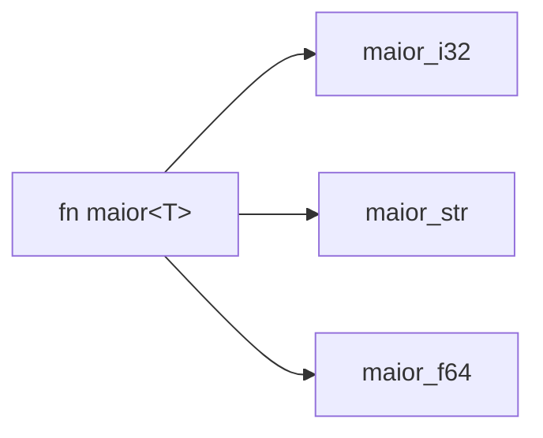

# Genéricos

**Genéricos** permitem escrever código para vários tipos sem duplicação.

```rust
// Função genérica: T precisa saber ser comparado
fn maior<T: PartialOrd>(lista: &[T]) -> &T {
    let mut m = &lista[0];
    for item in lista {
        if item > m {
            m = item;
        }
    }
    m
}

struct Par<T> {
    a: T,
    b: T,
}

// impl genérico com restrição
impl<T: std::fmt::Display + PartialOrd> Par<T> {
    fn mostra_maior(&self) {
        if self.a >= self.b {
            println!("a = {}", self.a);
        } else {
            println!("b = {}", self.b);
        }
    }
}

// impl específico para um tipo concreto
impl Par<f64> {
    fn distancia(&self) -> f64 {
        (self.a - self.b).abs()
    }
}

fn main() {
    println!("{}", maior(&[3, 9, 2]));
    println!("{}", maior(&["b", "z", "a"]));
    Par { a: 1, b: 2 }.mostra_maior();
    println!("{}", Par { a: 1.5, b: 4.0 }.distancia());

    // Turbofish: especificar o tipo explicitamente
    let n = "42".parse::<i32>().unwrap();
    let v = Vec::<u8>::with_capacity(4);
    println!("{n} {}", v.capacity() >= 4);
}
```

## Monomorfização

Para cada tipo concreto usado, o compilador gera uma **cópia especializada** da função. Resultado: sem custo em execução (como código escrito à mão), ao preço de binários maiores e compilação mais lenta.



> [!info] Constantes como parâmetros
> Além de tipos, é possível parametrizar valores constantes (`[T; N]`), os *const generics*.

## Exercício

Escreva `fn menor<T: PartialOrd + Copy>(a: T, b: T) -> T` e teste com inteiros e floats.

## Veja também

- [[Traits]]
- [[Trait bounds e where]]
- [[Zero-cost abstractions]]
- [[Option e Result]]
