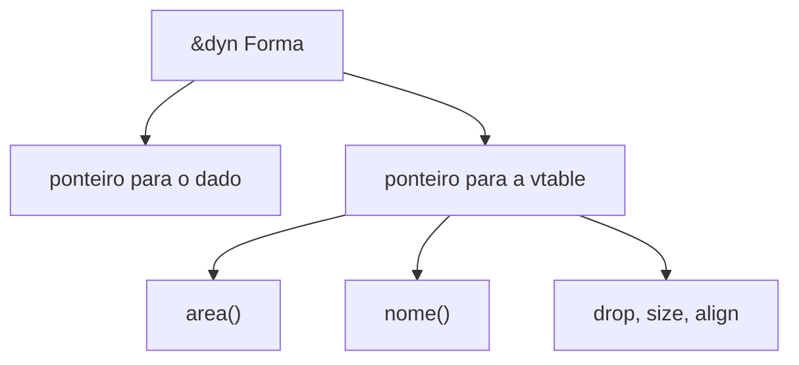

# impl Trait e dyn Trait

Há duas formas de abstrair sobre "qualquer tipo que implemente a trait":

| | `impl Trait` / genérico | `dyn Trait` |
|---|---|---|
| Resolução | Em compilação (**estática**) | Em execução (**dinâmica**, via vtable) |
| Custo | Zero (inlining possível) | Chamada indireta |
| Binário | Uma cópia por tipo | Uma só cópia |
| Coleção heterogênea | Não | **Sim** |
| Tamanho conhecido | Sim | Não (use `&dyn`, `Box<dyn>`) |

```rust
use std::f64::consts::PI;

trait Forma {
    fn area(&self) -> f64;
    fn nome(&self) -> String {
        "forma".to_string()
    }
}

struct Circulo(f64);
struct Quadrado(f64);

impl Forma for Circulo {
    fn area(&self) -> f64 {
        PI * self.0 * self.0
    }
    fn nome(&self) -> String {
        "círculo".to_string()
    }
}

impl Forma for Quadrado {
    fn area(&self) -> f64 {
        self.0 * self.0
    }
}

// Dispatch estático: uma versão por tipo
fn imprime_estatico(f: &impl Forma) {
    println!("{}: {:.2}", f.nome(), f.area());
}

// Dispatch dinâmico: uma função, qualquer implementador
fn imprime_dinamico(f: &dyn Forma) {
    println!("{}: {:.2}", f.nome(), f.area());
}

// Coleção heterogênea só é possível com trait objects
fn area_total(formas: &[Box<dyn Forma>]) -> f64 {
    formas.iter().map(|f| f.area()).sum()
}

// impl Trait em retorno: esconde o tipo concreto
fn pares(v: &[i32]) -> impl Iterator<Item = &i32> {
    v.iter().filter(|x| **x % 2 == 0)
}

fn main() {
    imprime_estatico(&Circulo(1.0));
    imprime_dinamico(&Quadrado(2.0));

    let formas: Vec<Box<dyn Forma>> = vec![Box::new(Circulo(1.0)), Box::new(Quadrado(2.0))];
    println!("{:.2}", area_total(&formas));

    println!("{:?}", pares(&[1, 2, 3, 4]).collect::<Vec<_>>());
}
```



> [!tip] Como escolher
> Comece com genéricos/`impl Trait`. Use `dyn Trait` quando precisar de **coleções heterogêneas**, plugins ou reduzir código gerado.

## Exercício

Crie `Vec<Box<dyn Forma>>` com três formas e imprima a de maior área.

## Veja também

- [[Traits]]
- [[Object safety]]
- [[Trait bounds e where]]
- [[Box]]
