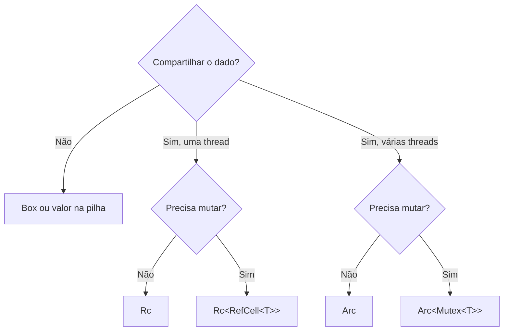

# Escolhendo ponteiro inteligente

| Tipo | Donos | Mutação | Threads | Verificação | Uso típico |
|---|---|---|---|---|---|
| `Box<T>` | 1 | via dono | se `T: Send` | compilação | recursão, trait objects |
| `Rc<T>` | N | não (só `&T`) | **não** | compilação | grafos/árvores single-thread |
| `Arc<T>` | N | não (só `&T`) | sim | compilação | dado compartilhado entre threads |
| `Cell<T>` | 1 | `set`/`get` | não | nenhuma | contadores simples |
| `RefCell<T>` | 1 | `borrow_mut` | não | **execução** | interior mutability |
| `Mutex<T>` | 1 | `lock()` | sim | execução (bloqueia) | estado compartilhado mutável |
| `RwLock<T>` | 1 | `write()` | sim | execução | muitas leituras |
| `Weak<T>` | 0 (observa) | n/a | conforme `Rc`/`Arc` | execução (`upgrade`) | quebrar ciclos |

Combinações comuns: `Rc<RefCell<T>>` (single-thread), `Arc<Mutex<T>>` (multi-thread).



## `Cow`: copiar só quando necessário

`Cow<'a, B>` (*clone-on-write*) guarda uma referência **ou** um valor próprio, e só aloca se for preciso alterar.

```rust
use std::borrow::Cow;

fn normaliza(s: &str) -> Cow<str> {
    if s.contains(' ') {
        Cow::Owned(s.replace(' ', "_")) // aloca somente quando há o que mudar
    } else {
        Cow::Borrowed(s)                // sem alocação
    }
}

fn main() {
    println!("{}", normaliza("sem_espacos"));
    println!("{}", normaliza("com espacos aqui"));
}
```

> [!tip] Comece simples
> Valores na pilha e `Box` resolvem a maioria dos casos. Adicione `Rc`/`Arc` quando o ownership compartilhado for realmente necessário.

## Veja também

- [[Box]]
- [[Rc]]
- [[Arc]]
- [[Cell e RefCell]]
- [[Weak e ciclos de referência]]
