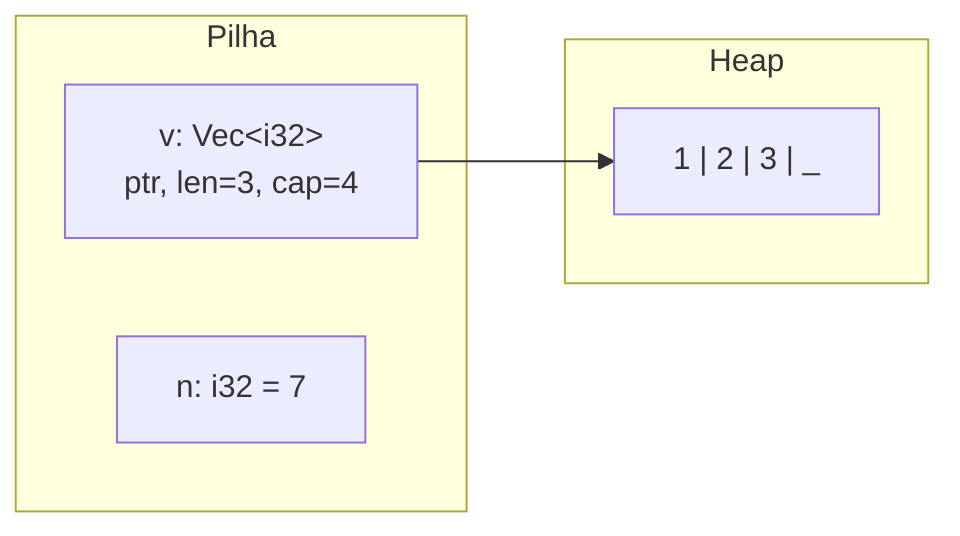

# Stack, heap e layout de memória

| | Pilha (stack) | Heap |
|---|---|---|
| Alocação | Mover o ponteiro da pilha (muito barata) | Pedir ao alocador (mais cara) |
| Tamanho | Fixo e conhecido em compilação | Dinâmico |
| Liberação | Automática ao sair do escopo | Quando o dono sofre `drop` |
| Exemplos | `i32`, `[u8; 4]`, structs simples, referências | conteúdo de `Box`, `Vec`, `String`, `Rc` |



## Medindo o layout

```rust
use std::mem::{align_of, size_of};

struct Reordenavel {
    a: u8,
    b: u32,
    c: u8,
}

#[repr(C)]
struct LayoutC {
    a: u8,
    b: u32,
    c: u8,
}

fn main() {
    println!("i32: {} bytes, align {}", size_of::<i32>(), align_of::<i32>());
    println!("&str: {} | String: {} | Vec<i32>: {}", size_of::<&str>(), size_of::<String>(), size_of::<Vec<i32>>());
    println!("[i32; 4]: {}", size_of::<[i32; 4]>());

    // Rust pode reordenar campos para economizar padding
    println!("Reordenavel: {}", size_of::<Reordenavel>());

    // repr(C) mantém a ordem de declaração: 1 + 3 padding + 4 + 1 + 3 padding
    assert_eq!(size_of::<LayoutC>(), 12);

    // Otimização de nicho: ponteiros nunca são nulos, então None usa o valor 0
    assert_eq!(size_of::<Option<Box<i32>>>(), size_of::<Box<i32>>());
    assert_eq!(size_of::<Option<&u8>>(), size_of::<&u8>());
}
```

> [!info] Representação
> Por padrão, o layout de structs de Rust **não é especificado**. Use `#[repr(C)]` para interoperar com C e `#[repr(transparent)]` para newtypes com o mesmo layout do campo.

> [!tip] Fat pointers
> `&str`, `&[T]` e `&dyn Trait` ocupam **dois** ponteiros: endereço + (tamanho ou vtable).

## Veja também

- [[Ownership e regras]]
- [[Box]]
- [[Drop e RAII]]
- [[Escolhendo ponteiro inteligente]]
