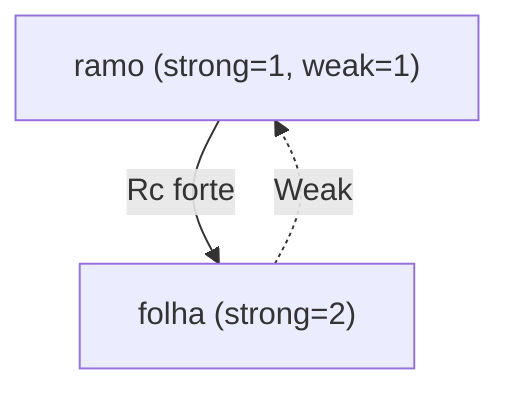

# Weak e ciclos de referência

Com `Rc`, é possível criar **ciclos** (A aponta para B e B para A): as contagens nunca chegam a zero e a memória **vaza** (isso é seguro, mas indesejado).

```rust
use std::cell::RefCell;
use std::rc::Rc;

struct Ciclo {
    prox: RefCell<Option<Rc<Ciclo>>>,
}

fn main() {
    let a = Rc::new(Ciclo { prox: RefCell::new(None) });
    let b = Rc::new(Ciclo { prox: RefCell::new(Some(Rc::clone(&a))) });
    *a.prox.borrow_mut() = Some(Rc::clone(&b)); // ciclo a -> b -> a

    // Cada um tem 2 donos (a variável + o outro nó): ao sair de main, nenhum chega a 0
    println!("a={} b={}", Rc::strong_count(&a), Rc::strong_count(&b));
}
```

## Solução: referências fracas

`Weak<T>` não conta como dono. Use `Rc::downgrade(&rc)` para criar e `.upgrade()` (retorna `Option<Rc<T>>`) para acessar, se o dado ainda existir.

```rust
use std::cell::RefCell;
use std::rc::{Rc, Weak};

#[derive(Debug)]
struct No {
    valor: i32,
    pai: RefCell<Weak<No>>,           // pai: fraca (não é dono)
    filhos: RefCell<Vec<Rc<No>>>,     // filhos: fortes (donos)
}

fn main() {
    let folha = Rc::new(No {
        valor: 3,
        pai: RefCell::new(Weak::new()),
        filhos: RefCell::new(vec![]),
    });
    println!("pai da folha = {:?}", folha.pai.borrow().upgrade().map(|p| p.valor));

    let ramo = Rc::new(No {
        valor: 5,
        pai: RefCell::new(Weak::new()),
        filhos: RefCell::new(vec![Rc::clone(&folha)]),
    });
    *folha.pai.borrow_mut() = Rc::downgrade(&ramo);

    println!("pai da folha = {:?}", folha.pai.borrow().upgrade().map(|p| p.valor));
    println!(
        "ramo: strong={} weak={}",
        Rc::strong_count(&ramo),
        Rc::weak_count(&ramo)
    );
    println!("filhos do ramo: {}", ramo.filhos.borrow().len());
}
```



> [!tip] Regra
> Relações "dono → dependente" usam `Rc`/`Arc`; "dependente → dono" (ponteiro para o pai, cache, observador) usam `Weak`.

## Veja também

- [[Rc]]
- [[Cell e RefCell]]
- [[Drop e RAII]]
