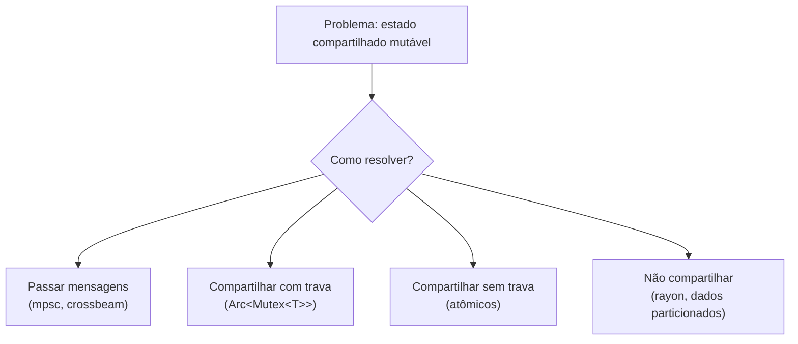

# Concorrência sem medo

**Concorrência** é lidar com várias tarefas em progresso; **paralelismo** é executá-las ao mesmo tempo em vários núcleos. Rust oferece os dois e transforma uma classe inteira de bugs (*data races*) em **erros de compilação**.

## Por que "sem medo"?

As regras de ownership e borrowing que protegem a memória também protegem entre threads:

- `&mut T` é **exclusivo**: nunca há dois escritores.
- `&T` compartilhada é **somente leitura** (exceto mutabilidade interior sincronizada).
- As traits `Send` e `Sync` marcam o que pode cruzar threads.

## Ferramentas

| Necessidade | Ferramenta | Nota |
|---|---|---|
| Executar trabalho em outra thread | `std::thread` | [[Threads]] |
| Enviar dados entre threads | `mpsc` | [[Canais mpsc]] |
| Estado mutável compartilhado | `Mutex`, `RwLock` | [[Mutex e RwLock]] |
| Contadores e flags sem lock | atômicos | [[Atômicos]] |
| Esperar uma condição | `Condvar`, `Barrier` | [[Condvar e Barrier]] |
| Paralelismo de dados | `rayon` | [[Rayon]] |
| Canais e estruturas avançadas | `crossbeam` | [[Crossbeam]] |
| Muitas tarefas de E/S | `async` | [[Async e await]] |

> [!tip] Mantra
> "Não se comunique compartilhando memória; compartilhe memória se comunicando." Prefira canais; use `Mutex` quando o estado compartilhado for realmente a melhor modelagem.

> [!info] O que Rust **não** impede
> *Deadlocks*, *race conditions* lógicas (erros de ordem de operações) e starvation continuam possíveis. Rust elimina *data races*, não todos os bugs de concorrência.

## Veja também

- [[Threads]]
- [[Data races]]
- [[Send e Sync]]
- [[Mutex e RwLock]]
- [[Canais mpsc]]
- [[Regras do borrow checker]]
