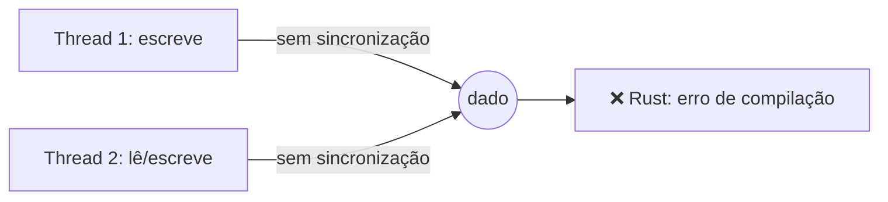

# Data races

Um **data race** ocorre quando:

1. duas ou mais threads acessam o mesmo dado ao mesmo tempo,
2. pelo menos uma escreve, e
3. não há sincronização.

Isso é **comportamento indefinido** em C/C++. Em Rust seguro, é **impossível**: o compilador recusa.

```rust
// ❌ NÃO COMPILA: a closure pode viver mais que `c`
use std::thread;

fn main() {
    let mut c = 0;
    let h = thread::spawn(|| {
        c += 1;
    });
    h.join().unwrap();
}
```

```text
error[E0373]: closure may outlive the current function, but it borrows `c`
```

Com `move`, o compilador aceita, mas a thread recebe uma **cópia**; não há compartilhamento, logo não há corrida:

```rust
use std::thread;

fn main() {
    let mut c = 0;
    let h = thread::spawn(move || {
        c += 1;
        c
    });
    println!("{} {}", h.join().unwrap(), c); // 1 0 (c da main não mudou)
}
```

Para compartilhar **e** mutar de verdade, o tipo precisa ser seguro entre threads: `Arc<Mutex<T>>` ou um atômico; veja [[Mutex e RwLock]].

> [!info] Data race ≠ race condition
> *Race condition* é um bug lógico de ordem (por exemplo, "verificar e depois agir" sem atomicidade). Rust não impede esses; apenas data races.



## Veja também

- [[Concorrência sem medo]]
- [[Regras do borrow checker]]
- [[Mutex e RwLock]]
