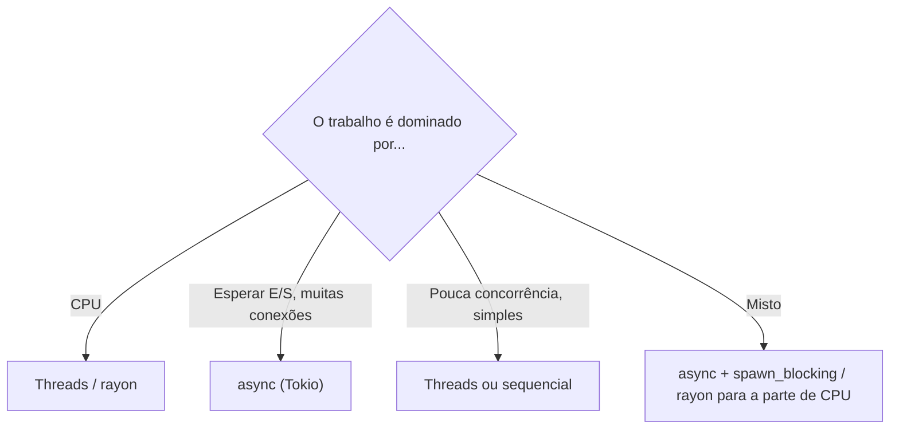

# Async vs threads

| Critério | Threads | Async |
|---|---|---|
| Tarefas simultâneas | centenas a milhares | **dezenas de milhares ou mais** |
| Custo por tarefa | pilha de ~MBs e troca de contexto do SO | alguns KBs, troca no espaço do usuário |
| Melhor para | **CPU** (cálculo pesado), APIs bloqueantes | **E/S** (rede, banco de dados, timers) |
| Complexidade | menor, código "normal" | maior (`Send`, `Pin`, cancelamento, runtime) |
| Ecossistema | `std` basta | exige runtime e bibliotecas compatíveis |
| Depuração | pilhas de chamadas claras | rastros mais difíceis |

> [!tip] Regra de bolso
> Servidor com muitas conexões simultâneas → async. Processamento paralelo de dados → threads/Rayon. Programa simples → comece sem concorrência.

> [!warning] Não é "mais rápido" por si só
> Async não acelera cálculo; ele evita desperdiçar threads esperando. Meça antes de assumir ganhos.

## Veja também

- [[Async e await]]
- [[Threads]]
- [[Concorrência sem medo]]
