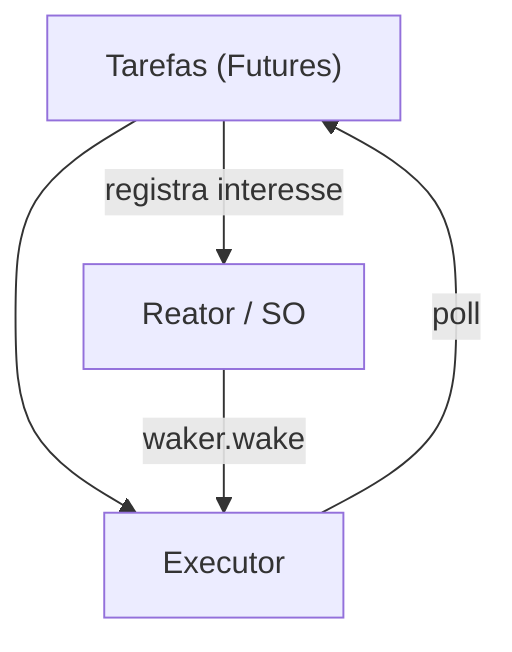

# Executores e runtimes

A biblioteca padrão define `Future`, mas **não** inclui executor. Você escolhe um **runtime**, que traz:

- **Executor:** agenda e chama `poll` nas tarefas;
- **Reator:** integra com o SO (epoll/kqueue/IOCP/io_uring) para avisar quando há E/S pronta;
- **Utilitários:** timers, sockets assíncronos, canais, sincronização.

| Runtime | Característica |
|---|---|
| **Tokio** | o mais usado; multi-thread com *work stealing*; ecossistema enorme (axum, reqwest, sqlx) |
| **smol** | pequeno e simples; ótimo para aprender e embutir |
| **async-std** | API espelhando a `std` |
| **Embassy** | async para microcontroladores (`no_std`) |
| **monoio / glommio** | baseados em io_uring, uma thread por núcleo |

> [!question] Verificar na documentação oficial
> Confira o estado atual de manutenção do `async-std` (houve anúncio de descontinuação em favor do `smol`) antes de adotá-lo em projetos novos.

> [!warning] Ecossistemas fragmentados
> Bibliotecas de E/S assíncrona costumam depender do runtime (Tokio, principalmente). Escolha um runtime cedo e mantenha-se nele no projeto.

## Veja também

- [[Future e Poll]]
- [[Tokio]]
- [[Async vs threads]]
