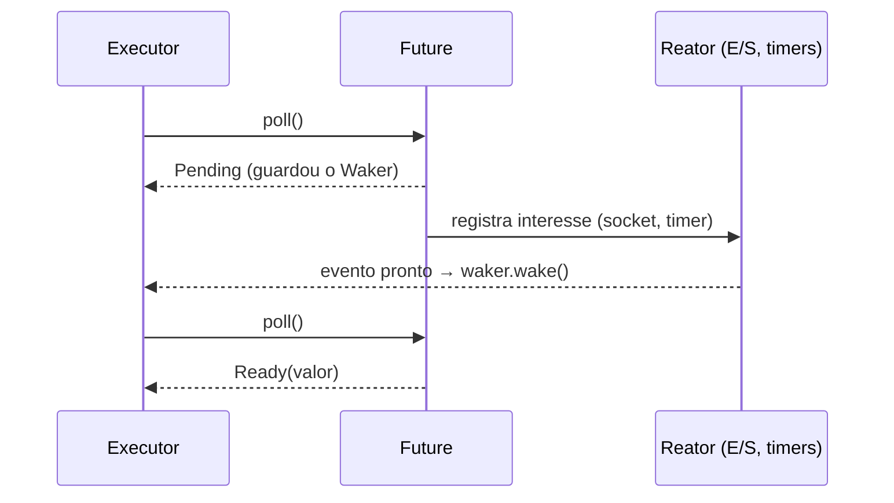

# Future e Poll

A trait central:

```rust
// trecho: definição simplificada de std::future::Future
pub trait Future {
    type Output;
    fn poll(self: Pin<&mut Self>, cx: &mut Context<'_>) -> Poll<Self::Output>;
}

pub enum Poll<T> {
    Ready(T),
    Pending,
}
```

- `poll` tenta avançar o Future. Se terminou: `Poll::Ready(valor)`. Se não: `Poll::Pending`.
- Ao devolver `Pending`, o Future **registra o `Waker`** (de `cx`) para ser acordado quando houver progresso possível. O executor não precisa ficar "perguntando" em laço.
- O compilador transforma cada `async fn` em uma **máquina de estados** que implementa `Future`.



## Implementando um Future à mão

```rust
use std::future::Future;
use std::pin::{pin, Pin};
use std::task::{Context, Poll, Waker};

struct Contagem {
    restante: u32,
}

impl Future for Contagem {
    type Output = &'static str;

    fn poll(mut self: Pin<&mut Self>, cx: &mut Context<'_>) -> Poll<Self::Output> {
        if self.restante == 0 {
            Poll::Ready("fim")
        } else {
            println!("faltam {}", self.restante);
            self.restante -= 1;
            // Pede para ser consultado de novo (acorda a si mesmo)
            cx.waker().wake_by_ref();
            Poll::Pending
        }
    }
}

fn block_on<F: Future>(fut: F) -> F::Output {
    let mut fut = pin!(fut);
    let mut cx = Context::from_waker(Waker::noop());
    loop {
        if let Poll::Ready(v) = fut.as_mut().poll(&mut cx) {
            return v;
        }
    }
}

async fn tarefa() {
    let msg = Contagem { restante: 3 }.await; // usa o Future manual dentro de async
    println!("{msg}");
}

fn main() {
    block_on(tarefa());
}
```

> [!warning] Nunca faça `Poll::Pending` sem arranjar o acordar
> Se um Future devolve `Pending` e ninguém chama o `Waker`, a tarefa nunca mais será consultada e "trava". No exemplo, `wake_by_ref` garante nova consulta.

## Veja também

- [[Async e await]]
- [[Pin]]
- [[Executores e runtimes]]
