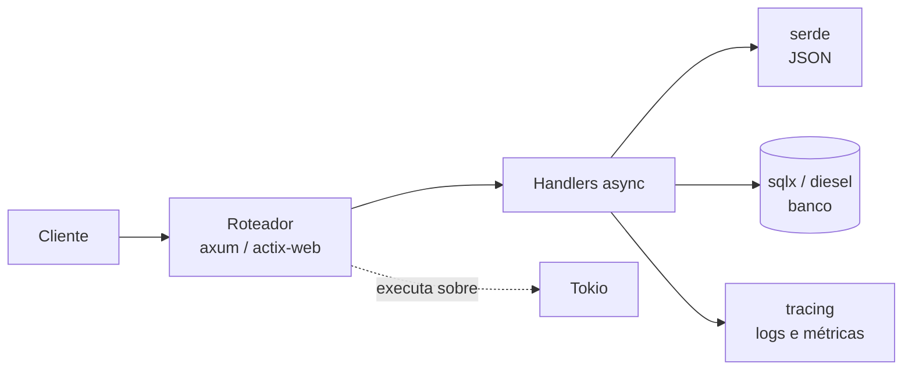

# Backend web com Rust

Rust é usado em backends onde **latência previsível** e **uso baixo de memória** importam. A combinação mais comum hoje:



| Camada | Crates |
|---|---|
| Runtime | [[Tokio]] |
| Framework HTTP | [[axum]] ou [[actix-web]] |
| JSON | [[serde e serde_json]] |
| Banco de dados | [[sqlx e diesel]] |
| Observabilidade | [[tracing]] |
| Cliente HTTP | [[reqwest]] |

## Esqueleto mínimo

```rust
// requer crate: axum, tokio
use axum::{routing::get, Json, Router};
use serde::Serialize;

#[derive(Serialize)]
struct Saude {
    status: &'static str,
}

async fn saude() -> Json<Saude> {
    Json(Saude { status: "ok" })
}

#[tokio::main]
async fn main() {
    let app = Router::new().route("/saude", get(saude));
    let listener = tokio::net::TcpListener::bind("0.0.0.0:3000").await.unwrap();
    axum::serve(listener, app).await.unwrap();
}
```

## Checklist de produção

- [ ] Erros convertidos em respostas HTTP (`IntoResponse`) — veja [[Erros customizados]].
- [ ] Timeouts e limites de tamanho de corpo.
- [ ] Pool de conexões configurado.
- [ ] Logs estruturados com [[tracing]] e *graceful shutdown*.
- [ ] Testes de integração chamando o `Router` diretamente — veja [[Testes de integração]].

> [!warning] Cuidado com bloqueios
> Código bloqueante (CPU pesada, I/O síncrono) dentro de handlers trava o executor; use `spawn_blocking`. Veja [[Armadilhas do async]].

## Veja também

- [[axum]]
- [[actix-web]]
- [[Tokio]]
- [[sqlx e diesel]]
- [[serde e serde_json]]
- [[tracing]]
- [[Async e await]]
