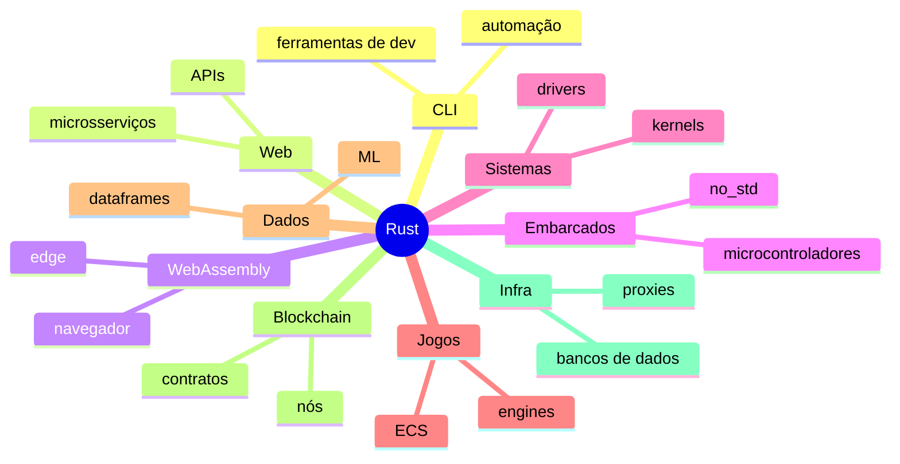

# Áreas de Aplicação

Rust nasceu para sistemas, mas o mesmo conjunto de garantias (segurança de memória, desempenho previsível, binários únicos) se aplica a muitos domínios.

| Área | Pontos fortes | Ferramentas típicas | Maturidade |
|---|---|---|---|
| [[CLI com Rust]] | binário único, rápido, multiplataforma | [[clap]], [[ratatui]] | ★★★★★ |
| [[Backend web com Rust]] | throughput, baixa latência, segurança | [[axum]], [[Tokio]], [[sqlx e diesel]] | ★★★★☆ |
| [[WebAssembly]] | desempenho no navegador e no edge | wasm-bindgen, wasm-pack | ★★★★☆ |
| [[Embarcados e no_std]] | sem runtime, sem GC | embassy, embedded-hal | ★★★★☆ |
| [[Sistemas operacionais em Rust]] | controle total com segurança | `core`, `alloc` | ★★★☆☆ |
| [[Jogos com Rust]] | ECS, paralelismo | [[bevy]] | ★★★☆☆ |
| [[Ciência de dados com Rust]] | velocidade em dataframes | polars, ndarray | ★★★☆☆ |
| [[Blockchain com Rust]] | segurança e determinismo | Solana, Substrate | ★★★★☆ |
| [[Infraestrutura e DevOps com Rust]] | proxies, agentes, bancos | Tokio, tonic | ★★★★☆ |

> [!question] Verificar na documentação oficial
> A maturidade do ecossistema de cada área muda rápido; as estrelas acima são uma avaliação aproximada. Consulte areweXyet (por exemplo, arewegameyet.rs, arewewebyet.org) e lib.rs.

> [!tip] Como escolher
> Comece por **CLI**: é o caminho mais curto do aprendizado à utilidade real, e os conceitos servem para todas as outras áreas.

## Veja também

- [[CLI com Rust]]
- [[Backend web com Rust]]
- [[WebAssembly]]
- [[Embarcados e no_std]]
- [[Sistemas operacionais em Rust]]
- [[Jogos com Rust]]
- [[Ciência de dados com Rust]]
- [[Blockchain com Rust]]
- [[Infraestrutura e DevOps com Rust]]
- [[Casos de uso do Rust]]
