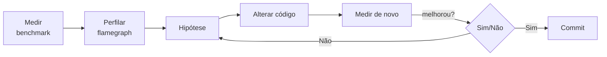

# Perfilamento

Regra de ouro: **meça antes de otimizar**. Perfilar mostra *onde* o programa gasta tempo ou memória.



## Preparar o perfil

Símbolos de depuração em *release* são essenciais para legibilidade:

```toml
[profile.release]
debug = true      # mantém símbolos (não afeta velocidade, só tamanho do binário)
```

## Ferramentas

| Ferramenta | Plataforma | Uso |
|---|---|---|
| `cargo flamegraph` | Linux/macOS | gera um gráfico de chamas SVG |
| `perf` | Linux | amostragem de CPU de baixo nível |
| `samply` | Linux/macOS/Windows | profiler com interface web (Firefox Profiler) |
| Instruments | macOS | profiler da Apple |
| `heaptrack` / `dhat` | Linux / crate | alocações de memória |
| `cargo bench` + [[Benchmarks com criterion]] | todas | micro-benchmarks com estatística |
| `cargo-llvm-lines`, `cargo bloat` | todas | tamanho do código gerado |

```bash
cargo install flamegraph
cargo flamegraph --release --bin meu_programa
# abre flamegraph.svg: largura = tempo gasto; pilha cresce para cima

cargo install samply
samply record ./target/release/meu_programa
```

## Medindo tempo no próprio código

```rust
use std::time::Instant;

fn trabalho() -> u64 {
    (1..=5_000_000u64).filter(|n| n % 3 == 0).sum()
}

fn main() {
    let inicio = Instant::now();
    let r = trabalho();
    let dur = inicio.elapsed();
    println!("resultado = {r} em {dur:?}");
}
```

> [!warning] Benchmark ingênuo mente
> O otimizador pode eliminar código "sem efeito". Use `std::hint::black_box` e ferramentas como criterion. Meça **sempre em release**.

> [!tip] O que procurar no flamegraph
> Plataformas largas (funções que consomem muito tempo), alocações em laços, `clone` desnecessário, `HashMap` com hasher lento e contenção de `Mutex`.

## Veja também

- [[Benchmarks com criterion]]
- [[Otimização de desempenho]]
- [[Debug vs release]]
- [[Release profile LTO e codegen]]
