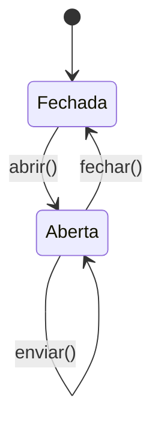

# Typestate

No padrão **typestate**, o **estado** de um objeto é codificado no seu **tipo**. Operações inválidas para aquele estado simplesmente **não compilam**.



```rust
use std::marker::PhantomData;

struct Fechada;
struct Aberta;

struct Conexao<Estado> {
    endereco: String,
    enviados: u32,
    _estado: PhantomData<Estado>,
}

impl Conexao<Fechada> {
    fn nova(endereco: &str) -> Self {
        Conexao { endereco: endereco.to_string(), enviados: 0, _estado: PhantomData }
    }

    fn abrir(self) -> Conexao<Aberta> {
        println!("abrindo {}", self.endereco);
        Conexao { endereco: self.endereco, enviados: self.enviados, _estado: PhantomData }
    }
}

impl Conexao<Aberta> {
    fn enviar(&mut self, msg: &str) {
        self.enviados += 1;
        println!("enviando '{msg}' ({} no total)", self.enviados);
    }

    fn fechar(self) -> Conexao<Fechada> {
        println!("fechando {}", self.endereco);
        Conexao { endereco: self.endereco, enviados: self.enviados, _estado: PhantomData }
    }
}

fn main() {
    let c = Conexao::nova("localhost:80");
    // c.enviar("oi"); // erro: `enviar` só existe para Conexao<Aberta>
    let mut c = c.abrir();
    c.enviar("oi");
    c.enviar("tudo bem?");
    let _c = c.fechar();
}
```

Se você tentar `Conexao::nova("x").enviar("oi")`:

```text
error[E0599]: no method named `enviar` found for struct `Conexao<Fechada>` in the current scope
```

> [!info] Como funciona
> Cada transição **consome** `self` (ownership) e devolve um valor de **outro tipo**; o estado antigo deixa de existir, graças ao [[Ownership e regras]].

Casos reais: *HALs* embarcados (pino como entrada ou saída), clientes de protocolo (handshake antes de enviar), *builders* que exigem campos obrigatórios (veja [[Builder]]).

## Veja também

- [[PhantomData]]
- [[Builder]]
- [[Enums]]
- [[Genéricos]]
- [[Embarcados e no_std]]
