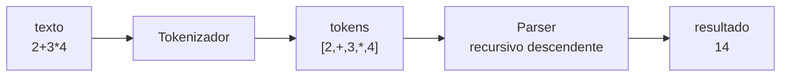

# Projeto 4 - Calculadora com parser

## Objetivos

Uma calculadora que avalia expressões como `2 + 3 * (4 - 1)` respeitando precedência, associatividade, parênteses e menos unário, usando um **analisador sintático recursivo descendente**.



**Gramática** (da menor para a maior precedência):

```text
expr      = termo  (('+' | '-') termo)*
termo     = unario (('*' | '/') unario)*
unario    = '-' unario | potencia
potencia  = primario ('^' unario)?        (associa à direita)
primario  = NÚMERO | '(' expr ')'
```

## Estrutura

```text
calculadora/
├── Cargo.toml
└── src/
    └── main.rs
```

## Código completo

```rust
use std::io::{self, BufRead, Write};

// ---------- 1. Tokenizador ----------

#[derive(Debug, Clone, PartialEq)]
enum Token {
    Num(f64),
    Mais,
    Menos,
    Vezes,
    Div,
    Pot,
    AbreP,
    FechaP,
}

fn tokenizar(entrada: &str) -> Result<Vec<Token>, String> {
    let mut tokens = Vec::new();
    let mut it = entrada.chars().peekable();

    while let Some(&c) = it.peek() {
        match c {
            ' ' | '\t' => {
                it.next();
            }
            '0'..='9' | '.' => {
                let mut numero = String::new();
                while let Some(&d) = it.peek() {
                    if d.is_ascii_digit() || d == '.' {
                        numero.push(d);
                        it.next();
                    } else {
                        break;
                    }
                }
                let n = numero
                    .parse::<f64>()
                    .map_err(|_| format!("número inválido: {numero}"))?;
                tokens.push(Token::Num(n));
            }
            '+' => { tokens.push(Token::Mais); it.next(); }
            '-' => { tokens.push(Token::Menos); it.next(); }
            '*' => { tokens.push(Token::Vezes); it.next(); }
            '/' => { tokens.push(Token::Div); it.next(); }
            '^' => { tokens.push(Token::Pot); it.next(); }
            '(' => { tokens.push(Token::AbreP); it.next(); }
            ')' => { tokens.push(Token::FechaP); it.next(); }
            outro => return Err(format!("caractere inesperado: '{outro}'")),
        }
    }
    Ok(tokens)
}

// ---------- 2. Parser + avaliação ----------

struct Parser {
    tokens: Vec<Token>,
    pos: usize,
}

impl Parser {
    fn new(tokens: Vec<Token>) -> Self {
        Parser { tokens, pos: 0 }
    }

    fn espiar(&self) -> Option<&Token> {
        self.tokens.get(self.pos)
    }

    fn avancar(&mut self) -> Option<Token> {
        let t = self.tokens.get(self.pos).cloned();
        self.pos += 1;
        t
    }

    // expr = termo (('+' | '-') termo)*
    fn expr(&mut self) -> Result<f64, String> {
        let mut valor = self.termo()?;
        while let Some(t) = self.espiar() {
            match t {
                Token::Mais => {
                    self.avancar();
                    valor += self.termo()?;
                }
                Token::Menos => {
                    self.avancar();
                    valor -= self.termo()?;
                }
                _ => break,
            }
        }
        Ok(valor)
    }

    // termo = unario (('*' | '/') unario)*
    fn termo(&mut self) -> Result<f64, String> {
        let mut valor = self.unario()?;
        while let Some(t) = self.espiar() {
            match t {
                Token::Vezes => {
                    self.avancar();
                    valor *= self.unario()?;
                }
                Token::Div => {
                    self.avancar();
                    let divisor = self.unario()?;
                    if divisor == 0.0 {
                        return Err("divisão por zero".to_string());
                    }
                    valor /= divisor;
                }
                _ => break,
            }
        }
        Ok(valor)
    }

    // unario = '-' unario | potencia
    fn unario(&mut self) -> Result<f64, String> {
        if self.espiar() == Some(&Token::Menos) {
            self.avancar();
            return Ok(-self.unario()?);
        }
        self.potencia()
    }

    // potencia = primario ('^' unario)?
    fn potencia(&mut self) -> Result<f64, String> {
        let base = self.primario()?;
        if self.espiar() == Some(&Token::Pot) {
            self.avancar();
            let expoente = self.unario()?; // recursão à direita
            return Ok(base.powf(expoente));
        }
        Ok(base)
    }

    // primario = NÚMERO | '(' expr ')'
    fn primario(&mut self) -> Result<f64, String> {
        match self.avancar() {
            Some(Token::Num(n)) => Ok(n),
            Some(Token::AbreP) => {
                let v = self.expr()?;
                match self.avancar() {
                    Some(Token::FechaP) => Ok(v),
                    _ => Err("esperado ')'".to_string()),
                }
            }
            Some(t) => Err(format!("token inesperado: {t:?}")),
            None => Err("expressão incompleta".to_string()),
        }
    }
}

fn avaliar(entrada: &str) -> Result<f64, String> {
    let tokens = tokenizar(entrada)?;
    if tokens.is_empty() {
        return Err("expressão vazia".to_string());
    }
    let mut parser = Parser::new(tokens);
    let valor = parser.expr()?;
    if parser.pos < parser.tokens.len() {
        return Err(format!("sobrou texto após a expressão: {:?}", parser.tokens[parser.pos]));
    }
    Ok(valor)
}

// ---------- 3. REPL ----------

fn main() {
    println!("Calculadora — digite uma expressão (Ctrl+D para sair)");
    let stdin = io::stdin();
    loop {
        print!("> ");
        io::stdout().flush().unwrap();
        let mut linha = String::new();
        if stdin.lock().read_line(&mut linha).unwrap() == 0 {
            break;
        }
        if linha.trim().is_empty() {
            continue;
        }
        match avaliar(&linha) {
            Ok(v) => println!("= {v}"),
            Err(e) => println!("erro: {e}"),
        }
    }
}

#[cfg(test)]
mod tests {
    use super::*;

    #[test]
    fn precedencia() {
        assert_eq!(avaliar("2 + 3 * 4"), Ok(14.0));
        assert_eq!(avaliar("(2 + 3) * 4"), Ok(20.0));
        assert_eq!(avaliar("10 - 4 - 3"), Ok(3.0)); // associa à esquerda
    }

    #[test]
    fn potencia_e_unario() {
        assert_eq!(avaliar("2 ^ 3 ^ 2"), Ok(512.0)); // associa à direita
        assert_eq!(avaliar("-2 ^ 2"), Ok(-4.0));
        assert_eq!(avaliar("2 ^ -1"), Ok(0.5));
        assert_eq!(avaliar("--3"), Ok(3.0));
    }

    #[test]
    fn decimais() {
        assert_eq!(avaliar("1.5 * 2"), Ok(3.0));
    }

    #[test]
    fn erros() {
        assert!(avaliar("1 / 0").is_err());
        assert!(avaliar("2 +").is_err());
        assert!(avaliar("(1 + 2").is_err());
        assert!(avaliar("1 2").is_err());
        assert!(avaliar("2 $ 3").is_err());
        assert!(avaliar("   ").is_err());
    }
}
```

## Como funciona

- **Cada regra da gramática é um método.** A precedência nasce da profundidade das chamadas: `expr` chama `termo`, que chama `unario`... então `*` "gruda" mais forte que `+`.
- **Associatividade:** `while` (esquerda, como em `10 - 4 - 3`) versus recursão à direita (`^`).
- **`peekable` + `espiar/avancar`** isolam a navegação pelos tokens do restante da lógica.
- O `enum Token` com `#[derive(PartialEq)]` permite comparar com `==`.

## Extensões

- [ ] Funções (`sqrt(9)`, `sin(x)`) e constantes (`pi`).
- [ ] Variáveis (`x = 5`, `x * 2`) com um `HashMap<String, f64>`.
- [ ] Construir uma **AST** (`enum Expr` com `Box`) em vez de avaliar durante a análise — passo para o [[Projeto 8 - Interpretador simples]].
- [ ] Mensagens de erro com a posição do caractere.
- [ ] Trocar `String` por um tipo de erro próprio ([[Erros customizados]]).

## Exercício

Adicione o operador de resto `%` com a mesma precedência de `*` e `/`, e escreva testes para ele.

## Veja também

- [[Enums]]
- [[Pattern matching avançado]]
- [[Iteradores]]
- [[Erros customizados]]
- [[Testes unitários]]
- [[Box]]
