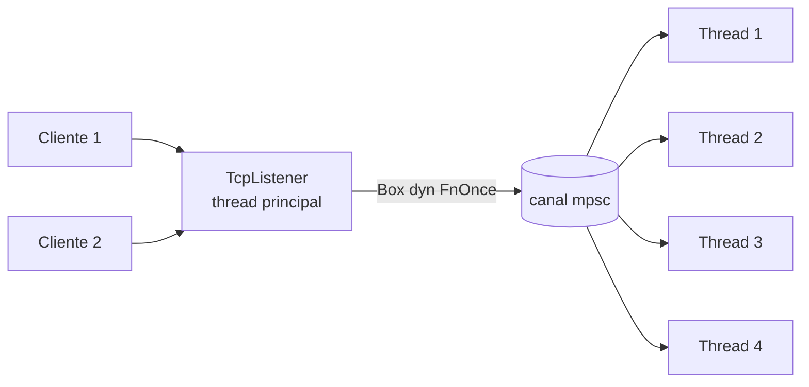

# Projeto 5 - Servidor HTTP com thread pool

## Objetivos

Construir, apenas com a biblioteca padrão, um servidor HTTP/1.1 minimalista que atende várias conexões em paralelo usando um **pool de threads** — o projeto final do *Rust Book*, aqui com roteamento e testes.

**Você vai praticar:** `TcpListener`, `BufReader`, `thread::spawn`, `mpsc`, `Arc<Mutex<_>>`, `Box<dyn FnOnce + Send>` e `Drop` para encerramento limpo.



## Estrutura

```text
servidor/
├── Cargo.toml
└── src/
    └── main.rs
```

```bash
cargo run
# em outro terminal:
curl -i http://127.0.0.1:7878/
curl -i http://127.0.0.1:7878/saudacao/Ana
curl -i http://127.0.0.1:7878/nao-existe
```

## Código completo

```rust
use std::io::{self, BufRead, BufReader, Write};
use std::net::{TcpListener, TcpStream};
use std::sync::{mpsc, Arc, Mutex};
use std::thread;

// ---------- Thread pool ----------

type Trabalho = Box<dyn FnOnce() + Send + 'static>;

struct Pool {
    trabalhadores: Vec<thread::JoinHandle<()>>,
    envio: Option<mpsc::Sender<Trabalho>>,
}

impl Pool {
    fn nova(n: usize) -> Pool {
        assert!(n > 0, "o pool precisa de ao menos 1 thread");
        let (tx, rx) = mpsc::channel::<Trabalho>();
        // Receiver não é Clone: compartilhamos com Arc<Mutex<_>>
        let rx = Arc::new(Mutex::new(rx));

        let mut trabalhadores = Vec::with_capacity(n);
        for _ in 0..n {
            let rx = Arc::clone(&rx);
            trabalhadores.push(thread::spawn(move || loop {
                // O guard do Mutex é solto no fim desta instrução `let`,
                // então outras threads podem receber enquanto esta trabalha.
                let mensagem = rx.lock().unwrap().recv();
                match mensagem {
                    Ok(trabalho) => trabalho(),
                    Err(_) => break, // canal fechado: encerrar
                }
            }));
        }
        Pool { trabalhadores, envio: Some(tx) }
    }

    fn executar<F>(&self, f: F)
    where
        F: FnOnce() + Send + 'static,
    {
        self.envio.as_ref().unwrap().send(Box::new(f)).unwrap();
    }
}

impl Drop for Pool {
    fn drop(&mut self) {
        drop(self.envio.take()); // fecha o canal: `recv` passa a devolver Err
        for t in self.trabalhadores.drain(..) {
            t.join().unwrap();
        }
    }
}

// ---------- HTTP ----------

/// Roteamento puro (sem E/S): devolve (código, corpo HTML).
fn responder(metodo: &str, caminho: &str) -> (u16, String) {
    if metodo != "GET" {
        return (405, "<h1>405 Método não permitido</h1>".to_string());
    }
    match caminho {
        "/" => (200, "<h1>Olá do servidor em Rust!</h1>".to_string()),
        c if c.starts_with("/saudacao/") => {
            let nome = &c["/saudacao/".len()..];
            (200, format!("<h1>Olá, {}!</h1>", escapar(nome)))
        }
        _ => (404, "<h1>404 Não encontrado</h1>".to_string()),
    }
}

/// Evita injeção de HTML (XSS) ao ecoar entrada do usuário.
fn escapar(s: &str) -> String {
    s.replace('&', "&amp;").replace('<', "&lt;").replace('>', "&gt;")
}

fn frase_status(codigo: u16) -> &'static str {
    match codigo {
        200 => "OK",
        404 => "Not Found",
        405 => "Method Not Allowed",
        _ => "Internal Server Error",
    }
}

fn montar_resposta(codigo: u16, corpo: &str) -> String {
    format!(
        "HTTP/1.1 {codigo} {}\r\nContent-Type: text/html; charset=utf-8\r\nContent-Length: {}\r\nConnection: close\r\n\r\n{corpo}",
        frase_status(codigo),
        corpo.len() // bytes, não caracteres
    )
}

fn tratar(mut stream: TcpStream) -> io::Result<()> {
    // Lê só a linha de requisição: "GET /caminho HTTP/1.1"
    let (metodo, caminho) = {
        let mut leitor = BufReader::new(&stream);
        let mut linha = String::new();
        leitor.read_line(&mut linha)?;
        let mut partes = linha.split_whitespace();
        (
            partes.next().unwrap_or("").to_string(),
            partes.next().unwrap_or("/").to_string(),
        )
    };

    let (codigo, corpo) = responder(&metodo, &caminho);
    stream.write_all(montar_resposta(codigo, &corpo).as_bytes())?;
    stream.flush()
}

fn main() -> io::Result<()> {
    let listener = TcpListener::bind("127.0.0.1:7878")?;
    let pool = Pool::nova(4);
    println!("Servidor em http://127.0.0.1:7878");

    for stream in listener.incoming() {
        let stream = stream?;
        pool.executar(move || {
            if let Err(e) = tratar(stream) {
                eprintln!("erro na conexão: {e}");
            }
        });
    }
    Ok(())
}

#[cfg(test)]
mod tests {
    use super::*;
    use std::sync::atomic::{AtomicUsize, Ordering};

    #[test]
    fn rotas() {
        assert_eq!(responder("GET", "/").0, 200);
        assert_eq!(responder("GET", "/x").0, 404);
        assert_eq!(responder("POST", "/").0, 405);
        assert!(responder("GET", "/saudacao/Ana").1.contains("Olá, Ana!"));
    }

    #[test]
    fn escapa_html() {
        let (_, corpo) = responder("GET", "/saudacao/<script>");
        assert!(!corpo.contains("<script>"));
        assert!(corpo.contains("&lt;script&gt;"));
    }

    #[test]
    fn content_length_conta_bytes() {
        let r = montar_resposta(200, "á");
        assert!(r.contains("Content-Length: 2"));
    }

    #[test]
    fn pool_executa_tudo_e_encerra() {
        let contador = Arc::new(AtomicUsize::new(0));
        {
            let pool = Pool::nova(3);
            for _ in 0..20 {
                let c = Arc::clone(&contador);
                pool.executar(move || {
                    c.fetch_add(1, Ordering::SeqCst);
                });
            }
        } // Drop do pool espera todas as threads
        assert_eq!(contador.load(Ordering::SeqCst), 20);
    }
}
```

## Como funciona

1. A thread principal só **aceita** conexões e envia um trabalho (closure) pelo canal.
2. As 4 threads disputam o `Receiver` protegido por `Mutex`; quem pegar executa a closure.
3. **Encerramento limpo:** o `Drop` fecha o `Sender`; cada `recv()` passa a devolver `Err`, as threads saem do `loop` e o `join` espera por elas. Veja [[Drop e RAII]].
4. `responder` é uma **função pura** — por isso é fácil de testar sem abrir sockets.

> [!warning] Segurança
> Este servidor é **didático**: não lê cabeçalhos nem corpo, não limita tamanho de requisições, não tem *timeouts*. Não o exponha à internet. Para produção use [[axum]] ou [[actix-web]].

## Extensões

- [ ] Servir arquivos estáticos de uma pasta (cuidado com *path traversal*: rejeite `..`).
- [ ] Ler e imprimir os cabeçalhos da requisição; suportar `POST` com corpo.
- [ ] Definir *timeouts* de leitura com `stream.set_read_timeout`.
- [ ] Contador de visitas com `Arc<Mutex<u64>>` ou [[Atômicos]].
- [ ] Encerrar graciosamente com Ctrl+C.
- [ ] Reescrever com [[Tokio]] e comparar com a versão baseada em threads ([[Async vs threads]]).

## Exercício

Adicione a rota `/hora` que devolve o horário (segundos desde 1970) usando `std::time::SystemTime`, e a rota `/soma/<a>/<b>` que responde 400 para entradas inválidas.

## Veja também

- [[Threads]]
- [[Canais mpsc]]
- [[Arc]]
- [[Mutex e RwLock]]
- [[Drop e RAII]]
- [[Box]]
- [[Fn, FnMut e FnOnce]]
- [[Send e Sync]]
