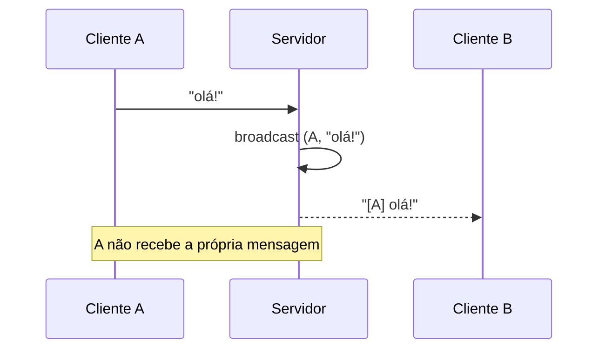

# Projeto 7 - Chat assíncrono com Tokio

## Objetivos

Um servidor de **chat por TCP**: cada cliente conecta (com `telnet`, `nc` ou o cliente abaixo), digita linhas e todas as outras pessoas conectadas as recebem em tempo real.



> [!question] Verificar na documentação oficial
> Código com crate externo (**tokio 1**), não compilado neste vault. Em especial, confirme a semântica de cancelamento de `read_line` dentro de `select!` na seção *Cancel safety* de docs.rs/tokio.

## Estrutura

```text
chat/
├── Cargo.toml
└── src/
    └── main.rs
```

```toml
[dependencies]
tokio = { version = "1", features = ["full"] }
```

## Código completo

```rust
// requer crate: tokio
use std::net::SocketAddr;
use tokio::io::{AsyncBufReadExt, AsyncWriteExt, BufReader};
use tokio::net::{TcpListener, TcpStream};
use tokio::sync::broadcast;

/// Mensagem difundida: quem enviou e o texto.
type Mensagem = (SocketAddr, String);

async fn atender(socket: TcpStream, addr: SocketAddr, tx: broadcast::Sender<Mensagem>) {
    // Cada cliente tem seu próprio receptor do canal de difusão
    let mut rx = tx.subscribe();
    let (leitor, mut escritor) = socket.into_split();
    let mut leitor = BufReader::new(leitor);
    let mut linha = String::new();

    println!("{addr} entrou");
    let _ = tx.send((addr, "entrou no chat".to_string()));

    loop {
        tokio::select! {
            // Ramo 1: o cliente enviou uma linha.
            // `linha` só é limpa depois de uma leitura completa, então se este
            // ramo for cancelado no meio, nenhum dado parcial é perdido.
            lido = leitor.read_line(&mut linha) => {
                match lido {
                    Ok(0) | Err(_) => break, // conexão encerrada
                    Ok(_) => {
                        let texto = linha.trim().to_string();
                        linha.clear();
                        if !texto.is_empty() {
                            let _ = tx.send((addr, texto));
                        }
                    }
                }
            }
            // Ramo 2: chegou mensagem de outra pessoa para repassar a este cliente.
            recebida = rx.recv() => {
                match recebida {
                    Ok((origem, texto)) if origem != addr => {
                        let saida = format!("[{origem}] {texto}\n");
                        if escritor.write_all(saida.as_bytes()).await.is_err() {
                            break;
                        }
                    }
                    Ok(_) => {} // mensagem própria: ignorar
                    Err(broadcast::error::RecvError::Lagged(n)) => {
                        // cliente lento perdeu n mensagens
                        let aviso = format!("(você perdeu {n} mensagens)\n");
                        let _ = escritor.write_all(aviso.as_bytes()).await;
                    }
                    Err(broadcast::error::RecvError::Closed) => break,
                }
            }
        }
    }

    println!("{addr} saiu");
    let _ = tx.send((addr, "saiu do chat".to_string()));
}

#[tokio::main]
async fn main() -> std::io::Result<()> {
    let listener = TcpListener::bind("127.0.0.1:8080").await?;
    // Capacidade 100: mensagens em trânsito antes de um receptor lento "atrasar"
    let (tx, _) = broadcast::channel::<Mensagem>(100);
    println!("Chat ouvindo em 127.0.0.1:8080  (use: nc 127.0.0.1 8080)");

    loop {
        let (socket, addr) = listener.accept().await?;
        let tx = tx.clone();
        // Uma *task* leve por cliente (não é uma thread do SO)
        tokio::spawn(atender(socket, addr, tx));
    }
}
```

## Como testar

```bash
cargo run
# em três terminais diferentes:
nc 127.0.0.1 8080
```

## Como funciona

- **`broadcast::channel`**: múltiplos produtores e múltiplos consumidores; cada `subscribe()` recebe **todas** as mensagens enviadas depois. Veja [[Canais assíncronos]].
- **`tokio::select!`** espera duas coisas ao mesmo tempo — leitura do socket e mensagens do canal — e executa o ramo que ficar pronto primeiro. Veja [[join! e select!]].
- **`tokio::spawn`** cria uma *task* por cliente; milhares delas cabem em poucas threads. Compare em [[Async vs threads]].
- `into_split` separa leitura e escrita do `TcpStream`, permitindo que cada metade seja usada sem conflito de empréstimos.

> [!warning] Armadilha
> Nunca segure um `std::sync::Mutex` através de um `.await` nem faça trabalho bloqueante nas tasks — veja [[Armadilhas do async]].

## Extensões

- [ ] Pedir um apelido na conexão e mostrá-lo no lugar do endereço.
- [ ] Comandos como `/quem` (listar conectados, com `Arc<Mutex<HashMap<..>>>`) e `/sair`.
- [ ] Salas de chat (um canal `broadcast` por sala).
- [ ] Limite de tamanho de linha e *timeout* de inatividade (`tokio::time::timeout`).
- [ ] Um cliente de terminal escrito em Rust com `select!` entre `stdin` e o socket.
- [ ] TLS com `tokio-rustls`.

## Exercício

Implemente o comando `/apelido <nome>` que muda o nome exibido do cliente nas mensagens seguintes.

## Veja também

- [[Tokio]]
- [[join! e select!]]
- [[Canais assíncronos]]
- [[Async e await]]
- [[Armadilhas do async]]
- [[Executores e runtimes]]
