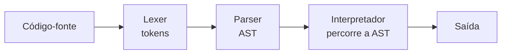

# Projeto 8 - Interpretador simples

## Objetivos

Criar um interpretador para uma mini-linguagem com variáveis, aritmética, comparações, `if/else` e `while`:

```text
let n = 5;
let r = 1;
while n > 0 {
    r = r * n;
    n = n - 1;
}
print r;          // 120
```

É a evolução do [[Projeto 4 - Calculadora com parser]]: em vez de avaliar durante a análise, o parser constrói uma **AST** (árvore sintática abstrata) que depois é percorrida (*tree-walking interpreter*).



**Gramática:**

```text
programa  = comando*
comando   = 'let' ID '=' expr ';'
          | ID '=' expr ';'
          | 'print' expr ';'
          | 'if' expr bloco ('else' bloco)?
          | 'while' expr bloco
bloco     = '{' comando* '}'
expr      = soma (('<' | '>' | '==') soma)?
soma      = termo (('+' | '-') termo)*
termo     = unario (('*' | '/') unario)*
unario    = '-' unario | primario
primario  = NÚMERO | ID | '(' expr ')'
```

Valores são `f64`; nas condições, `0` é falso e qualquer outro valor é verdadeiro; comparações devolvem `1` ou `0`.

## Estrutura

```text
interpretador/
├── Cargo.toml
└── src/
    └── main.rs        # (extensão: separar em lexer.rs, parser.rs, interp.rs)
```

```bash
cargo run                    # roda o programa de demonstração
cargo run -- programa.txt    # roda um arquivo
```

## Código completo

```rust
use std::collections::HashMap;
use std::env;
use std::fs;

// ============ 1. Lexer ============

#[derive(Debug, Clone, PartialEq)]
enum Tok {
    Num(f64),
    Id(String),
    Let,
    Print,
    If,
    Else,
    While,
    Mais,
    Menos,
    Vezes,
    Div,
    Menor,
    Maior,
    IgualIgual,
    Igual,
    AP,
    FP,
    AC,
    FC,
    PV,
}

fn lexer(src: &str) -> Result<Vec<Tok>, String> {
    let chars: Vec<char> = src.chars().collect();
    let mut i = 0;
    let mut toks = Vec::new();

    while i < chars.len() {
        let c = chars[i];
        match c {
            c if c.is_whitespace() => i += 1,
            // comentário de linha: // até o fim da linha
            '/' if chars.get(i + 1) == Some(&'/') => {
                while i < chars.len() && chars[i] != '\n' {
                    i += 1;
                }
            }
            '0'..='9' => {
                let ini = i;
                while i < chars.len() && (chars[i].is_ascii_digit() || chars[i] == '.') {
                    i += 1;
                }
                let texto: String = chars[ini..i].iter().collect();
                toks.push(Tok::Num(texto.parse().map_err(|_| format!("número inválido: {texto}"))?));
            }
            c if c.is_alphabetic() || c == '_' => {
                let ini = i;
                while i < chars.len() && (chars[i].is_alphanumeric() || chars[i] == '_') {
                    i += 1;
                }
                let palavra: String = chars[ini..i].iter().collect();
                toks.push(match palavra.as_str() {
                    "let" => Tok::Let,
                    "print" => Tok::Print,
                    "if" => Tok::If,
                    "else" => Tok::Else,
                    "while" => Tok::While,
                    _ => Tok::Id(palavra),
                });
            }
            '=' => {
                if chars.get(i + 1) == Some(&'=') {
                    toks.push(Tok::IgualIgual);
                    i += 2;
                } else {
                    toks.push(Tok::Igual);
                    i += 1;
                }
            }
            _ => {
                toks.push(match c {
                    '+' => Tok::Mais,
                    '-' => Tok::Menos,
                    '*' => Tok::Vezes,
                    '/' => Tok::Div,
                    '<' => Tok::Menor,
                    '>' => Tok::Maior,
                    '(' => Tok::AP,
                    ')' => Tok::FP,
                    '{' => Tok::AC,
                    '}' => Tok::FC,
                    ';' => Tok::PV,
                    outro => return Err(format!("caractere inesperado: '{outro}'")),
                });
                i += 1;
            }
        }
    }
    Ok(toks)
}

// ============ 2. AST ============

#[derive(Debug, Clone, Copy, PartialEq)]
enum Op {
    Add,
    Sub,
    Mul,
    Div,
    Lt,
    Gt,
    Eq,
}

#[derive(Debug, Clone)]
enum Expr {
    Num(f64),
    Var(String),
    Neg(Box<Expr>),
    Bin(Box<Expr>, Op, Box<Expr>),
}

#[derive(Debug, Clone)]
enum Stmt {
    Let(String, Expr),
    Assign(String, Expr),
    Print(Expr),
    If(Expr, Vec<Stmt>, Vec<Stmt>),
    While(Expr, Vec<Stmt>),
}

// ============ 3. Parser ============

struct Parser {
    toks: Vec<Tok>,
    pos: usize,
}

impl Parser {
    fn espiar(&self) -> Option<&Tok> {
        self.toks.get(self.pos)
    }

    fn proximo(&mut self) -> Option<Tok> {
        let t = self.toks.get(self.pos).cloned();
        self.pos += 1;
        t
    }

    fn esperar(&mut self, esperado: Tok) -> Result<(), String> {
        match self.proximo() {
            Some(ref t) if *t == esperado => Ok(()),
            outro => Err(format!("esperado {esperado:?}, encontrado {outro:?}")),
        }
    }

    fn identificador(&mut self) -> Result<String, String> {
        match self.proximo() {
            Some(Tok::Id(nome)) => Ok(nome),
            outro => Err(format!("esperado um identificador, encontrado {outro:?}")),
        }
    }

    fn programa(&mut self) -> Result<Vec<Stmt>, String> {
        let mut cmds = Vec::new();
        while self.espiar().is_some() {
            cmds.push(self.comando()?);
        }
        Ok(cmds)
    }

    fn bloco(&mut self) -> Result<Vec<Stmt>, String> {
        self.esperar(Tok::AC)?;
        let mut cmds = Vec::new();
        while self.espiar() != Some(&Tok::FC) {
            if self.espiar().is_none() {
                return Err("bloco não fechado: falta '}'".to_string());
            }
            cmds.push(self.comando()?);
        }
        self.esperar(Tok::FC)?;
        Ok(cmds)
    }

    fn comando(&mut self) -> Result<Stmt, String> {
        // `cloned` solta o empréstimo de self antes de chamar métodos &mut
        match self.espiar().cloned() {
            Some(Tok::Let) => {
                self.proximo();
                let nome = self.identificador()?;
                self.esperar(Tok::Igual)?;
                let e = self.expr()?;
                self.esperar(Tok::PV)?;
                Ok(Stmt::Let(nome, e))
            }
            Some(Tok::Print) => {
                self.proximo();
                let e = self.expr()?;
                self.esperar(Tok::PV)?;
                Ok(Stmt::Print(e))
            }
            Some(Tok::If) => {
                self.proximo();
                let cond = self.expr()?;
                let entao = self.bloco()?;
                let senao = if self.espiar() == Some(&Tok::Else) {
                    self.proximo();
                    self.bloco()?
                } else {
                    Vec::new()
                };
                Ok(Stmt::If(cond, entao, senao))
            }
            Some(Tok::While) => {
                self.proximo();
                let cond = self.expr()?;
                let corpo = self.bloco()?;
                Ok(Stmt::While(cond, corpo))
            }
            Some(Tok::Id(_)) => {
                let nome = self.identificador()?;
                self.esperar(Tok::Igual)?;
                let e = self.expr()?;
                self.esperar(Tok::PV)?;
                Ok(Stmt::Assign(nome, e))
            }
            outro => Err(format!("comando inesperado: {outro:?}")),
        }
    }

    // expr = soma (('<' | '>' | '==') soma)?
    fn expr(&mut self) -> Result<Expr, String> {
        let esq = self.soma()?;
        let op = match self.espiar() {
            Some(Tok::Menor) => Op::Lt,
            Some(Tok::Maior) => Op::Gt,
            Some(Tok::IgualIgual) => Op::Eq,
            _ => return Ok(esq),
        };
        self.proximo();
        let dir = self.soma()?;
        Ok(Expr::Bin(Box::new(esq), op, Box::new(dir)))
    }

    fn soma(&mut self) -> Result<Expr, String> {
        let mut esq = self.termo()?;
        loop {
            let op = match self.espiar() {
                Some(Tok::Mais) => Op::Add,
                Some(Tok::Menos) => Op::Sub,
                _ => break,
            };
            self.proximo();
            let dir = self.termo()?;
            esq = Expr::Bin(Box::new(esq), op, Box::new(dir));
        }
        Ok(esq)
    }

    fn termo(&mut self) -> Result<Expr, String> {
        let mut esq = self.unario()?;
        loop {
            let op = match self.espiar() {
                Some(Tok::Vezes) => Op::Mul,
                Some(Tok::Div) => Op::Div,
                _ => break,
            };
            self.proximo();
            let dir = self.unario()?;
            esq = Expr::Bin(Box::new(esq), op, Box::new(dir));
        }
        Ok(esq)
    }

    fn unario(&mut self) -> Result<Expr, String> {
        if self.espiar() == Some(&Tok::Menos) {
            self.proximo();
            return Ok(Expr::Neg(Box::new(self.unario()?)));
        }
        self.primario()
    }

    fn primario(&mut self) -> Result<Expr, String> {
        match self.proximo() {
            Some(Tok::Num(n)) => Ok(Expr::Num(n)),
            Some(Tok::Id(nome)) => Ok(Expr::Var(nome)),
            Some(Tok::AP) => {
                let e = self.expr()?;
                self.esperar(Tok::FP)?;
                Ok(e)
            }
            outro => Err(format!("expressão inesperada: {outro:?}")),
        }
    }
}

// ============ 4. Interpretador ============

const LIMITE_PASSOS: u64 = 1_000_000;

struct Interpretador {
    vars: HashMap<String, f64>,
    saida: Vec<String>,
    passos: u64,
}

impl Interpretador {
    fn novo() -> Self {
        Interpretador { vars: HashMap::new(), saida: Vec::new(), passos: 0 }
    }

    fn avaliar(&self, e: &Expr) -> Result<f64, String> {
        Ok(match e {
            Expr::Num(n) => *n,
            Expr::Var(nome) => *self
                .vars
                .get(nome)
                .ok_or_else(|| format!("variável não definida: '{nome}'"))?,
            Expr::Neg(inner) => -self.avaliar(inner)?,
            Expr::Bin(a, op, b) => {
                let (x, y) = (self.avaliar(a)?, self.avaliar(b)?);
                match op {
                    Op::Add => x + y,
                    Op::Sub => x - y,
                    Op::Mul => x * y,
                    Op::Div => {
                        if y == 0.0 {
                            return Err("divisão por zero".to_string());
                        }
                        x / y
                    }
                    Op::Lt => (x < y) as u8 as f64,
                    Op::Gt => (x > y) as u8 as f64,
                    Op::Eq => (x == y) as u8 as f64,
                }
            }
        })
    }

    fn executar(&mut self, cmds: &[Stmt]) -> Result<(), String> {
        for cmd in cmds {
            self.passos += 1;
            if self.passos > LIMITE_PASSOS {
                return Err("limite de passos excedido (laço infinito?)".to_string());
            }
            match cmd {
                Stmt::Let(nome, e) => {
                    let v = self.avaliar(e)?;
                    self.vars.insert(nome.clone(), v);
                }
                Stmt::Assign(nome, e) => {
                    let v = self.avaliar(e)?;
                    match self.vars.get_mut(nome) {
                        Some(slot) => *slot = v,
                        None => return Err(format!("atribuição a variável não declarada: '{nome}'")),
                    }
                }
                Stmt::Print(e) => {
                    let v = self.avaliar(e)?;
                    self.saida.push(format!("{v}"));
                }
                Stmt::If(cond, entao, senao) => {
                    if self.avaliar(cond)? != 0.0 {
                        self.executar(entao)?;
                    } else {
                        self.executar(senao)?;
                    }
                }
                Stmt::While(cond, corpo) => {
                    while self.avaliar(cond)? != 0.0 {
                        // conta cada volta: um corpo vazio também não pode girar para sempre
                        self.passos += 1;
                        if self.passos > LIMITE_PASSOS {
                            return Err("limite de passos excedido (laço infinito?)".to_string());
                        }
                        self.executar(corpo)?;
                    }
                }
            }
        }
        Ok(())
    }
}

/// Executa um programa e devolve as linhas impressas por `print`.
fn rodar(src: &str) -> Result<Vec<String>, String> {
    let toks = lexer(src)?;
    let mut parser = Parser { toks, pos: 0 };
    let programa = parser.programa()?;
    let mut interp = Interpretador::novo();
    interp.executar(&programa)?;
    Ok(interp.saida)
}

const DEMO: &str = "
// fatorial e sequência de Fibonacci
let n = 5;
let r = 1;
while n > 0 {
    r = r * n;
    n = n - 1;
}
print r;

let a = 0;
let b = 1;
let i = 0;
while i < 10 {
    print a;
    let t = a + b;
    a = b;
    b = t;
    i = i + 1;
}

if r == 120 { print 1; } else { print 0; }
";

fn main() {
    let fonte = match env::args().nth(1) {
        Some(caminho) => fs::read_to_string(&caminho).unwrap_or_else(|e| {
            eprintln!("não foi possível ler '{caminho}': {e}");
            std::process::exit(2);
        }),
        None => DEMO.to_string(),
    };

    match rodar(&fonte) {
        Ok(linhas) => linhas.iter().for_each(|l| println!("{l}")),
        Err(e) => {
            eprintln!("erro: {e}");
            std::process::exit(1);
        }
    }
}

#[cfg(test)]
mod tests {
    use super::*;

    fn saida(src: &str) -> Vec<String> {
        rodar(src).unwrap()
    }

    #[test]
    fn aritmetica_e_precedencia() {
        assert_eq!(saida("print 2 + 3 * 4;"), vec!["14"]);
        assert_eq!(saida("print (2 + 3) * 4;"), vec!["20"]);
        assert_eq!(saida("print -2 * 3;"), vec!["-6"]);
    }

    #[test]
    fn variaveis_e_atribuicao() {
        assert_eq!(saida("let x = 1; x = x + 41; print x;"), vec!["42"]);
    }

    #[test]
    fn fatorial_com_while() {
        let prog = "let n = 5; let r = 1; while n > 0 { r = r * n; n = n - 1; } print r;";
        assert_eq!(saida(prog), vec!["120"]);
    }

    #[test]
    fn if_else() {
        assert_eq!(saida("if 1 < 2 { print 10; } else { print 20; }"), vec!["10"]);
        assert_eq!(saida("if 2 < 1 { print 10; } else { print 20; }"), vec!["20"]);
    }

    #[test]
    fn comentarios_sao_ignorados() {
        assert_eq!(saida("// nada\nprint 7; // fim"), vec!["7"]);
    }

    #[test]
    fn erros() {
        assert!(rodar("print x;").is_err());          // variável inexistente
        assert!(rodar("x = 1;").is_err());            // atribuição sem let
        assert!(rodar("print 1 / 0;").is_err());      // divisão por zero
        assert!(rodar("print 1").is_err());           // falta ';'
        assert!(rodar("while 1 { }").is_err());       // laço infinito detectado
        assert!(rodar("let a = 1; if a { print 1; ").is_err()); // bloco aberto
        assert!(rodar("print 2 $ 3;").is_err());
    }
}
```

## Como funciona

- **AST com `Box`:** `Expr` é recursivo, então os filhos precisam estar atrás de `Box` para o tipo ter tamanho conhecido. Veja [[Box]] e [[Enums]].
- **Três fases desacopladas:** o lexer entrega `Vec<Tok>`, o parser `Vec<Stmt>` e o interpretador só conhece a AST — cada etapa é testável isolada.
- **`match self.espiar().cloned()`** evita o conflito entre o empréstimo imutável de `espiar` e as chamadas `&mut self` dentro do braço.
- **Ambiente:** um `HashMap<String, f64>` guarda as variáveis; `get_mut` permite atribuir somente a variáveis já declaradas.
- **Proteção contra laços infinitos:** o contador de passos transforma um travamento em um erro previsível.

## Extensões

- [ ] Escopo de blocos (pilha de `HashMap`) e variáveis locais.
- [ ] Novos tipos: `bool`, `string` (`enum Valor`), operadores `&&`, `||`, `!=`, `<=`, `>=`.
- [ ] Funções definidas pelo usuário (`fn soma(a, b) { return a + b; }`) com pilha de chamadas e recursão.
- [ ] Erros com linha e coluna (guarde a posição em cada `Tok`).
- [ ] Um REPL interativo mantendo o ambiente entre linhas.
- [ ] Compilar a AST para *bytecode* e executar em uma máquina de pilha — é o caminho das linguagens reais.
- [ ] Ler *Crafting Interpreters* (craftinginterpreters.com) e portar o `Lox` para Rust.

## Exercício

Adicione `<=`, `>=` e `!=` e o comando `break` dentro de `while`.

## Veja também

- [[Enums]]
- [[Box]]
- [[Pattern matching avançado]]
- [[HashMap]]
- [[Erros customizados]]
- [[Projeto 4 - Calculadora com parser]]
- [[Testes unitários]]
