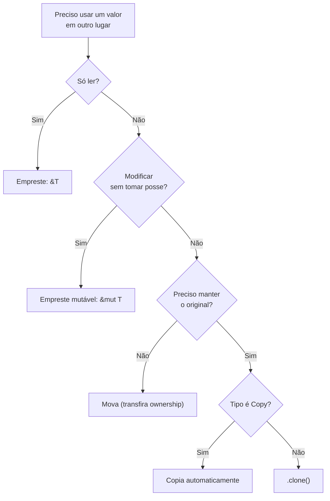

# Cheat sheet de ownership

## As três regras

1. Todo valor tem **um único dono**.
2. Quando o dono sai de escopo, o valor é liberado (`Drop`).
3. Em qualquer momento: **uma** referência mutável `&mut T` **ou** **várias** referências `&T`, nunca ambos ao mesmo tempo.

## Diagrama de decisão



## Tabela de referência rápida

| Quero... | Parâmetro | Quem chama escreve |
|---|---|---|
| Só ler | `&T` / `&str` / `&[T]` | `f(&x)` |
| Modificar | `&mut T` | `f(&mut x)` |
| Consumir (tomar posse) | `T` | `f(x)` (x não pode mais ser usado, se não for `Copy`) |
| Aceitar `String` ou `&str` | `impl AsRef<str>` ou `&str` | `f(&s)` / `f("lit")` |
| Aceitar qualquer conversível | `impl Into<String>` | `f("lit")` / `f(s)` |

## Move, Copy e Clone

| | Move | Copy | Clone |
|---|---|---|---|
| Como acontece | atribuição, passagem, retorno | implícita, bit a bit | explícita: `.clone()` |
| Original ainda válido? | **não** | sim | sim |
| Tipos | `String`, `Vec<T>`, `Box<T>`... | inteiros, `bool`, `char`, `&T`, tuplas de `Copy` | quase todos |
| Custo | barato (copia ponteiro) | barato | pode ser caro |

## Erros típicos e saídas

| Erro | Saída |
|---|---|
| E0382 uso após *move* | emprestar (`&`), `.clone()`, ou restruturar |
| E0502 `&` e `&mut` ao mesmo tempo | reduzir o escopo do empréstimo; separar leitura de escrita |
| E0499 dois `&mut` | um por vez; dividir com `split_at_mut` |
| E0505 mover enquanto emprestado | terminar de usar a referência antes |
| E0515 retornar referência local | retornar o valor (`String`) em vez de `&str` |
| E0597 não vive o bastante | declarar o dono em escopo mais externo |

## Quando a regra "atrapalha"

| Problema | Ferramenta |
|---|---|
| Vários donos, uma thread | [[Rc]] |
| Vários donos, várias threads | [[Arc]] |
| Mutar atrás de referência compartilhada, uma thread | [[Cell e RefCell]] |
| Mutar com várias threads | `Arc<Mutex<T>>` — [[Mutex e RwLock]] |
| Ciclos | [[Weak e ciclos de referência]] |
| Valor no heap / recursão | [[Box]] |

```rust
fn tamanho(s: &String) -> usize {
    s.len() // empresta: não toma posse
}

fn anexa(s: &mut String) {
    s.push_str("!"); // modifica o original
}

fn consome(s: String) -> usize {
    s.len() // s é liberada ao fim da função
}

fn main() {
    let mut a = String::from("oi");
    println!("{}", tamanho(&a));
    anexa(&mut a);
    let b = a.clone();      // cópia profunda: a continua válida
    println!("{}", consome(a)); // a foi movida
    // println!("{a}");     // erro: uso após move
    println!("{b}");
}
```

Veja também o canvas [[Mapa do Ownership.canvas]].

## Veja também

- [[Ownership e regras]]
- [[Move, Copy e Clone]]
- [[Borrowing e referências]]
- [[Lifetimes]]
- [[Escolhendo ponteiro inteligente]]
- [[Mapa do Ownership.canvas]]
