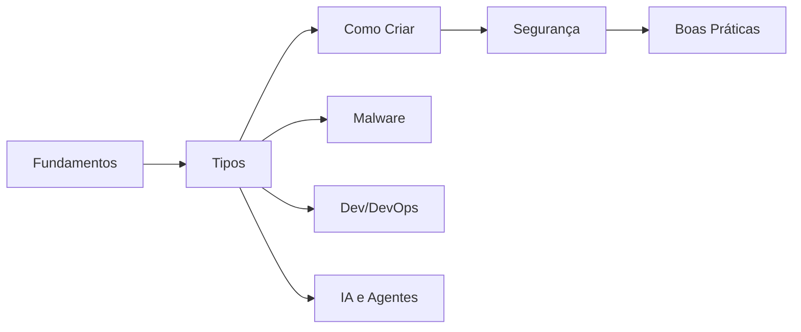

---
tags:
  - moc
aliases: []
tipo: moc
nivel: iniciante
criado: 2026-10-24
relacionados:
  - "[[Índice Geral - Sandbox]]"
  - "[[Trilha de Aprendizado - Sandbox]]"
---
# Home

Bem-vindo ao vault **Ambientes Sandbox — Material de Estudos**. Este material fica na pasta `Sandbox-Vault` do vault **Materiais-Obsidian** (veja o [[GUIA]]). Use o Graph view para explorar.

> [!info] Uso responsável
> Todo o conteúdo é educativo e defensivo. Execute comandos somente em ambiente de laboratório, com dados fictícios e sistemas que você possui ou tem autorização para usar.

## Por onde começar

- Trilha de estudos: [[Trilha de Aprendizado - Sandbox]]
- Índice geral: [[Índice Geral - Sandbox]]
- Glossário: [[Glossário#Sandboxes e isolamento]] · FAQ: [[FAQ de Sandboxes]]

## Mapas de conteúdo (MOCs)

| Seção | MOC |
|---|---|
| 01 Fundamentos | [[MOC - Fundamentos - Sandbox]] |
| 02 Casos de Uso | [[MOC - Casos de Uso]] |
| 03 Tipos de Sandbox | [[MOC - Tipos de Sandbox]] |
| 04 Como Criar | [[MOC - Como Criar]] |
| 05 Cuidados e Segurança | [[MOC - Cuidados e Segurança]] |
| 06 Ferramentas | [[MOC - Ferramentas]] |
| 07 Análise de Malware | [[MOC - Análise de Malware]] |
| 08 Dev e DevOps | [[MOC - Dev e DevOps]] |
| 09 IA e Agentes | [[MOC - IA e Agentes]] |
| 10 Boas Práticas | [[MOC - Boas Práticas]] |
| 11 Referência | [[MOC - Referência - Sandbox]] |
| 12 Exercícios e Casos | [[MOC - Exercícios e Casos]] |
| Anexos (Canvas) | [[MOC - Anexos]] |
| Templates | [[MOC - Templates]] |

## Mapas visuais

- [[Espectro de isolamento.canvas]]
- [[Modelo de ameaças.canvas]]
- [[Mapa conceitual de sandbox.canvas]]

## Veja também

- [[Índice Geral - Sandbox]]
