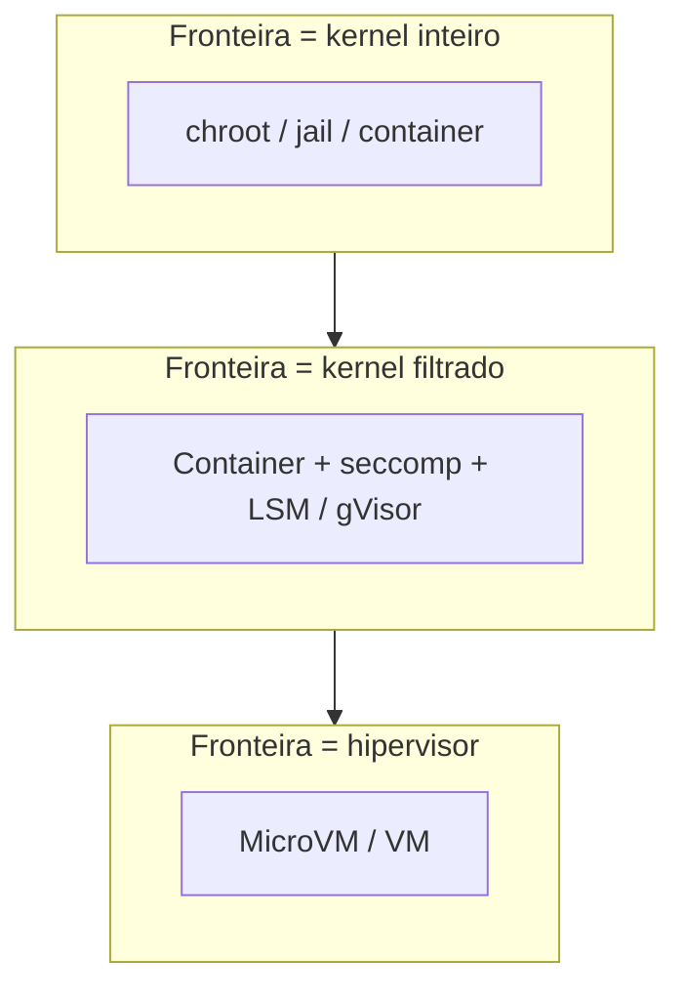

---
tags:
  - fundamentos
aliases:
  - "Isolation"
  - "Containment"
tipo: conceito
nivel: iniciante
criado: 2026-10-24
relacionados:
  - "[[O que é um Ambiente Sandbox]]"
  - "[[Namespaces do Linux]]"
  - "[[Cgroups]]"
  - "[[Fuga de Sandbox]]"
---
# Isolamento e Contenção

**Isolamento** é a separação de recursos: um processo não enxerga o que está fora da sua visão. **Contenção** é a limitação de dano: mesmo que algo dê errado, o problema não se espalha.

## Dimensões de isolamento

| Dimensão | O que separa | Mecanismos típicos |
|---|---|---|
| Processos | Quem enxerga quais PIDs | PID namespace |
| Sistema de arquivos | Quais caminhos existem | Mount namespace, chroot, overlayfs |
| Rede | Interfaces, rotas, portas | Network namespace, firewalls |
| Usuários | Mapeamento de UIDs | User namespace |
| Recursos | CPU, memória, E/S | [[Cgroups]] |
| Chamadas de sistema | O que o kernel aceita | [[Seccomp]], LSMs |
| Hardware | CPU, memória, dispositivos | Virtualização |

## Isolamento forte vs. fraco

A força depende de **quanto código compartilhado** existe entre a sandbox e o hospedeiro. Containers compartilham o **kernel** do host; VMs têm kernel próprio e só compartilham o hipervisor, que é bem menor.

> [!info] Contenção também é tempo e recurso
> Um laço infinito ou *fork bomb* é um ataque de negação de serviço contra o host. Limites de CPU, memória, processos e tempo fazem parte da contenção.

## Exercício

Em uma folha, desenhe três caixas aninhadas (aplicação, sandbox, host) e marque onde ficam as fronteiras de arquivos, rede e processos.

## Veja também

- [[O que é um Ambiente Sandbox]]
- [[Namespaces do Linux]]
- [[Cgroups]]
- [[Superfície de Ataque]]
- [[Sandbox vs VM vs Container vs Jail vs chroot]]
