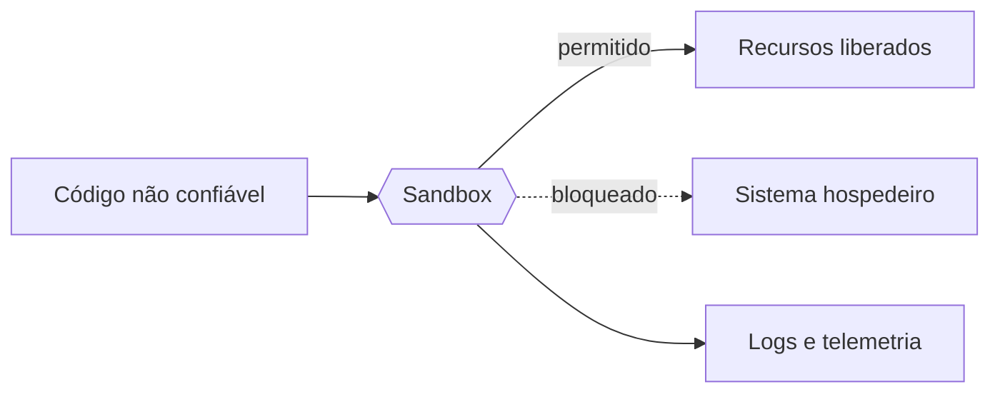

---
tags:
  - fundamentos
  - sandbox
aliases:
  - Sandbox
  - Caixa de areia
  - Ambiente isolado
tipo: conceito
nivel: iniciante
criado: 2026-10-24
relacionados:
  - "[[Isolamento e Contenção]]"
  - "[[Princípio do Menor Privilégio]]"
  - "[[Superfície de Ataque]]"
  - "[[MOC - Fundamentos - Sandbox]]"
---
# O que é um Ambiente Sandbox

Um **ambiente sandbox** (caixa de areia) é um espaço controlado e isolado onde código, arquivos ou aplicações podem ser executados com **acesso restrito** ao restante do sistema. O que acontece dentro da caixa — erros, falhas, comportamento malicioso — deve ficar contido nela.

## Ideia central

Em vez de *confiar* no que vai rodar, assumimos que pode dar errado e limitamos o estrago de antemão. Três perguntas definem qualquer sandbox:

1. **O que o código pode ver?** (arquivos, processos, variáveis de ambiente)
2. **O que o código pode fazer?** (chamadas de sistema, rede, dispositivos)
3. **Quanto ele pode consumir?** (CPU, memória, disco, tempo)

## Propriedades desejáveis

| Propriedade | Significado |
|---|---|
| Isolamento | Separação de recursos entre o conteúdo da sandbox e o hospedeiro |
| Contenção | Falhas e ataques não se propagam para fora |
| Menor privilégio | Só as permissões estritamente necessárias |
| Reprodutibilidade | Estado inicial conhecido e repetível |
| Descartabilidade | Pode ser destruída e recriada sem dor |
| Observabilidade | Dá para registrar e inspecionar o que ocorreu |

> [!info] Sandbox não é um produto, é um objetivo
> "Sandbox" descreve **o resultado** (execução restrita), não uma tecnologia específica. Pode ser implementada com filtros de syscalls, containers, máquinas virtuais, WebAssembly e muito mais. Veja o espectro em [[Sandbox vs VM vs Container vs Jail vs chroot]].

> [!warning] Nenhuma sandbox é perfeita
> Toda sandbox tem uma fronteira, e fronteiras têm falhas. Por isso usamos camadas — ver [[Defesa em Profundidade]] e [[Fuga de Sandbox]].

## Exercício

Liste três situações do seu dia a dia em que você já usa uma sandbox sem perceber (ex.: abas do navegador, apps do celular). Para cada uma, escreva o que ela impede.

## Veja também

- [[Isolamento e Contenção]]
- [[Princípio do Menor Privilégio]]
- [[História e Evolução das Sandboxes]]
- [[Sandbox vs VM vs Container vs Jail vs chroot]]
- [[MOC - Fundamentos - Sandbox]]
