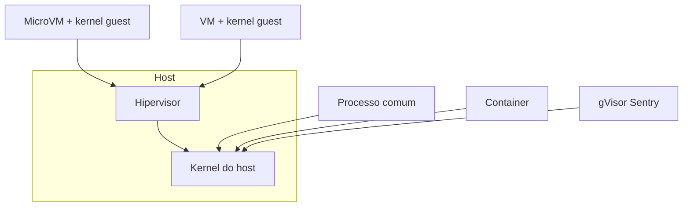

---
tags:
  - fundamentos
aliases:
  - "Comparativo de isolamento"
  - "Sandbox ou VM ou container"
tipo: comparacao
nivel: iniciante
criado: 2026-10-24
relacionados:
  - "[[Isolamento e Contenção]]"
  - "[[Namespaces do Linux]]"
  - "[[Cgroups]]"
  - "[[Sandbox por Containers]]"
  - "[[Sandbox por Virtualização Completa]]"
---
# Sandbox vs VM vs Container vs Jail vs chroot

Termos parecidos, garantias muito diferentes. **Sandbox** é o objetivo; os demais são mecanismos para atingi-lo.

| Mecanismo | Kernel próprio? | Isola | Fronteira de segurança | Custo/Overhead |
|---|---|---|---|---|
| `chroot` | Não | Só a raiz do sistema de arquivos | **Fraca** (root escapa com facilidade) | Mínimo |
| Jail (FreeBSD) | Não | Processos, arquivos, rede, usuários | Média | Baixo |
| Container (namespaces + cgroups) | Não (compartilha o do host) | Visão de recursos e limites | Média; melhora com seccomp, LSM, rootless | Baixo |
| Container + gVisor | "Kernel" em espaço de usuário | Filtra e reimplementa syscalls | Média-alta | Médio |
| MicroVM | Sim (guest) | Hardware virtual mínimo | Alta | Baixo-médio |
| VM completa | Sim (guest) | Hardware virtual completo | Alta | Alto |
| Máquina física dedicada (*air gap*) | Sim | Tudo | Muito alta | Muito alto |

## Como escolher

- **Código confiável, só precisa de reprodutibilidade:** container comum.
- **Código semiconfiável (plugins, CI):** container endurecido (rootless, seccomp, `--cap-drop=ALL`).
- **Código não confiável / multi-inquilino / malware:** microVM ou VM, em rede isolada.

> [!warning] "Está em um container" não significa "está seguro"
> Containers padrão compartilham o kernel. Uma vulnerabilidade de kernel pode permitir fuga. Veja [[Fuga de Sandbox]].

> [!tip] chroot não é segurança
> Serve para conveniência (ex.: ambientes de build). Não use como fronteira contra código hostil.

## Exercício

Preencha de memória a coluna 'Fronteira de segurança' e depois confira com a tabela. Em quais linhas você errou?

## Veja também

- [[Isolamento e Contenção]]
- [[Namespaces do Linux]]
- [[Cgroups]]
- [[Capabilities do Linux]]
- [[Defesa em Profundidade]]
