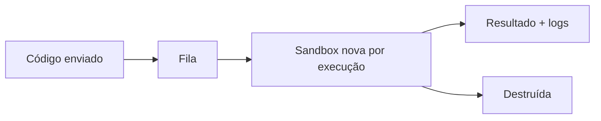

---
tags:
  - casos-de-uso
aliases:
  - "Untrusted code"
tipo: caso-de-uso
nivel: intermediario
criado: 2026-10-24
relacionados:
  - "[[Sandbox por MicroVMs]]"
  - "[[Sandbox por WebAssembly]]"
  - "[[Sandbox por Kernel em Espaço de Usuário]]"
---
# Caso - Execução de Código Não Confiável

Plataformas de programação online, correção automática de exercícios e funções serverless executam **código de terceiros**. A premissa é: o código é hostil.

Requisitos mínimos: limites de CPU/memória/tempo, sem rede (ou rede controlada), sistema de arquivos efêmero, usuário sem privilégios, um ambiente **por execução**.

> [!danger] Containers comuns não bastam para multi-inquilino hostil
> Prefira microVMs ou gVisor quando o risco for alto. Veja [[Sandbox vs VM vs Container vs Jail vs chroot]].

## Exercício

Defina os limites (CPU, memória, tempo, rede) para uma plataforma que roda exercícios de Python de alunos.

## Veja também

- [[Sandbox por MicroVMs]]
- [[Sandbox por Kernel em Espaço de Usuário]]
- [[Sandbox por WebAssembly]]
- [[MOC - Casos de Uso]]
