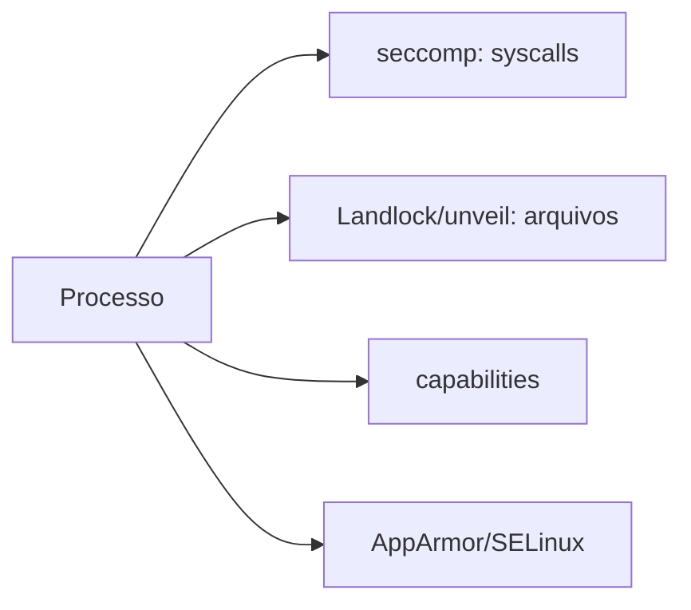

---
tags:
  - tipos
aliases:
  - "Process sandbox"
tipo: tipo-de-sandbox
nivel: intermediario
criado: 2026-10-24
relacionados:
  - "[[Seccomp]]"
  - "[[Landlock pledge e unveil]]"
  - "[[Capabilities do Linux]]"
---
# Sandbox de Processo

Restringe **um único processo** sem criar um sistema separado. É leve e muito usado dentro de navegadores, servidores e utilitários.

| Técnica | Restringe |
|---|---|
| [[Seccomp]] | Syscalls |
| [[Landlock pledge e unveil]] | Arquivos (e outras ações) |
| [[Capabilities do Linux]] | Poderes do root |
| LSMs (AppArmor, SELinux) | Políticas obrigatórias por programa |
| Usuário dedicado sem privilégios | Permissões de arquivo |

> [!tip] Combine camadas
> Cada técnica cobre uma lacuna da outra. Ver [[Defesa em Profundidade]].

## Veja também

- [[Seccomp]]
- [[Landlock pledge e unveil]]
- [[Sandbox de Aplicação]]
- [[MOC - Tipos de Sandbox]]
