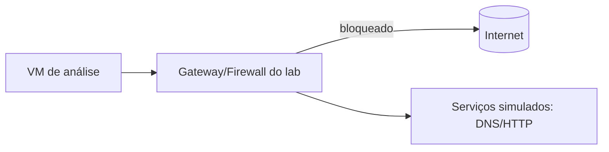

---
tags:
  - tipos
aliases:
  - "Rede isolada"
  - "Honeypots"
  - "Cyber ranges"
tipo: tipo-de-sandbox
nivel: intermediario
criado: 2026-10-24
relacionados:
  - "[[Honeypots e Cyber Ranges]]"
  - "[[Caso - Análise de Malware]]"
  - "[[Criar Laboratório de Malware Seguro]]"
---
# Sandbox de Rede

Isolamento no nível da **rede**: segmentos sem acesso à internet ou à rede interna, ou com saída controlada.

| Modelo | Descrição |
|---|---|
| Rede interna (host-only) | VMs conversam entre si; sem saída |
| Internet simulada | Serviços falsos (DNS, HTTP) respondem às amostras |
| Saída filtrada | Somente destinos/portas permitidos |
| VLAN/segmentação | Separação física/lógica do laboratório |

> [!danger] Cuidado com vazamentos de DNS e ICMP
> Mesmo "sem internet", consultas DNS podem sair. Teste o isolamento antes de usar.

## Exercício

Em um laboratório, verifique com `ping` e `nslookup` que uma VM em rede host-only realmente não alcança a internet.

## Veja também

- [[Honeypots e Cyber Ranges]]
- [[Criar Laboratório de Malware Seguro]]
- [[Caso - Análise de Malware]]
- [[MOC - Tipos de Sandbox]]
