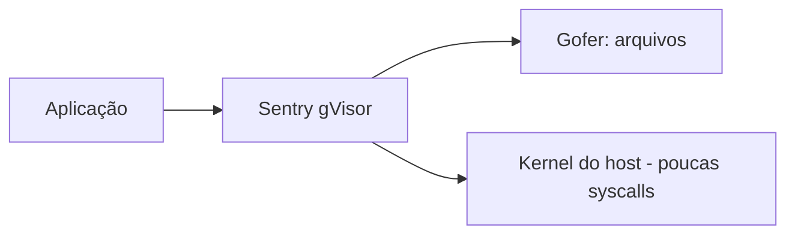

---
tags:
  - tipos
aliases:
  - "gVisor"
tipo: tipo-de-sandbox
nivel: intermediario
criado: 2026-10-24
relacionados:
  - "[[Criar Sandbox com gVisor]]"
  - "[[Sandbox por Containers]]"
  - "[[Seccomp]]"
---
# Sandbox por Kernel em Espaço de Usuário

O **gVisor** implementa um "kernel" em espaço de usuário (o *Sentry*, escrito em Go) que **intercepta e reimplementa** as syscalls da aplicação. Assim, a aplicação não conversa diretamente com o kernel do host; o Sentry usa um conjunto reduzido de syscalls.

- Integra-se ao Docker/Kubernetes como runtime OCI (`runsc`).
- Reduz a superfície de ataque do kernel do host.
- Custo: **sobrecarga** em E/S e syscalls e **compatibilidade parcial** com algumas aplicações.

## Veja também

- [[Criar Sandbox com gVisor]]
- [[Sandbox por Containers]]
- [[Sandbox por MicroVMs]]
- [[MOC - Tipos de Sandbox]]
