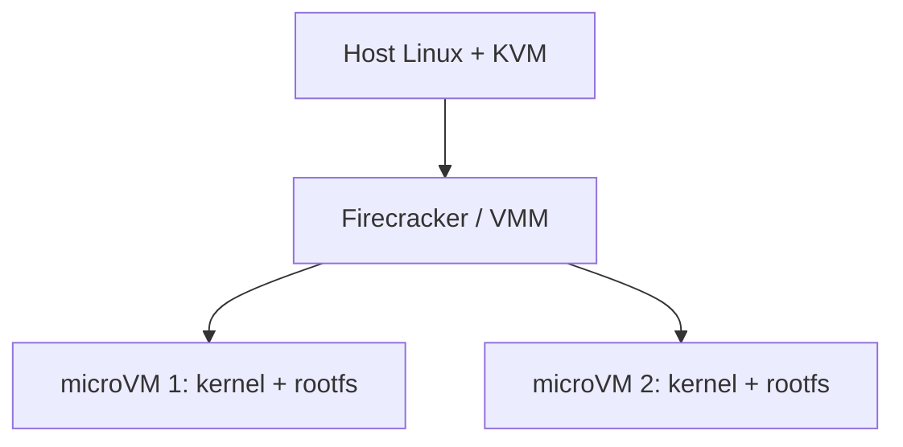

---
tags:
  - tipos
aliases:
  - "Firecracker"
  - "Cloud Hypervisor"
  - "Kata Containers"
  - "microVM"
tipo: tipo-de-sandbox
nivel: intermediario
criado: 2026-10-24
relacionados:
  - "[[Criar Sandbox com Firecracker]]"
  - "[[Sandbox por Containers]]"
  - "[[Hipervisores Tipo 1 e Tipo 2]]"
---
# Sandbox por MicroVMs

MicroVMs são VMs **minimalistas**: poucos dispositivos virtuais, boot rápido e baixo consumo, mantendo o isolamento por hardware.

| Projeto | Nota |
|---|---|
| **Firecracker** | Baseado em KVM, escrito em Rust; usado em serviços serverless da AWS |
| **Cloud Hypervisor** | VMM em Rust voltado a cargas na nuvem |
| **Kata Containers** | Executa containers OCI/Kubernetes dentro de VMs leves |

> [!info] Por que são populares para IA e serverless
> Combinam a velocidade de containers com a fronteira de segurança de VMs, ideal para executar código de terceiros por requisição.

> [!question] Verificar na documentação oficial
> Requisitos (KVM, versões de kernel, CPUs) e API mudam entre versões; use a documentação do projeto.

## Veja também

- [[Criar Sandbox com Firecracker]]
- [[Sandbox por Containers]]
- [[Sandbox em Nuvem]]
- [[Hipervisores Tipo 1 e Tipo 2]]
- [[MOC - Tipos de Sandbox]]
