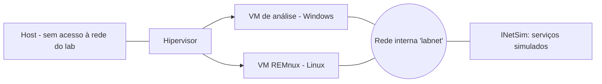

---
tags:
  - como-criar
aliases:
  - "Laboratório de análise"
tipo: procedimento
nivel: avancado
criado: 2026-10-24
relacionados:
  - "[[Laboratório de Análise de Malware]]"
  - "[[Sandbox de Rede]]"
  - "[[Criar Sandbox com VMs]]"
---
# Criar Laboratório de Malware Seguro

> [!warning] Uso estritamente defensivo e educacional
> Esta nota descreve **infraestrutura de contenção**. Trabalhe apenas com amostras obtidas legalmente, em ambiente isolado, e jamais execute código suspeito na sua máquina principal.

## Arquitetura



## Passos

1. **Host dedicado** (idealmente um computador separado) com disco criptografado.
2. **Rede interna** sem rota para a internet (ex.: `--nic1 intnet --intnet1 labnet` no VirtualBox).
3. **VM de análise** com ferramentas defensivas instaladas (ex.: FLARE-VM) e **VM de apoio Linux** (REMnux) com INetSim para simular DNS/HTTP.
4. **Snapshot "limpo"** antes de qualquer análise; reverter após cada amostra.
5. **Sem integrações:** sem Guest Additions desnecessárias, pastas compartilhadas, área de transferência ou USB.
6. **Transferência de amostras** unidirecional (ex.: ISO somente leitura montada na VM).
7. **Teste de isolamento** antes de começar.

```bash
# Dentro da VM de análise: tudo isto DEVE falhar
ping -c 2 1.1.1.1
nslookup exemplo.com 1.1.1.1
curl -m 5 https://exemplo.com
```

## Checklist antes de usar

- [ ] Rede do lab sem rota para a LAN e a internet
- [ ] Snapshot limpo criado
- [ ] Nenhuma pasta compartilhada
- [ ] Área de transferência desativada
- [ ] Credenciais pessoais ausentes das VMs
- [ ] Hipervisor atualizado

> [!question] Verificar na documentação oficial
> Procedimentos de instalação do FLARE-VM, REMnux e INetSim mudam; siga a documentação de cada projeto.

## Exercício

Monte a rede interna e execute o teste de isolamento acima. Documente os resultados.

## Veja também

- [[Laboratório de Análise de Malware]]
- [[Sandbox de Rede]]
- [[Criar Sandbox com VMs]]
- [[Fuga de Sandbox]]
- [[MOC - Como Criar]]
