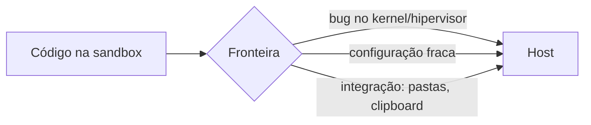

---
tags:
  - seguranca
aliases:
  - "Sandbox escape"
  - "Container escape"
  - "VM escape"
tipo: cuidado
nivel: avancado
criado: 2026-10-24
relacionados:
  - "[[Superfície de Ataque]]"
  - "[[Defesa em Profundidade]]"
  - "[[Modelo de Ameaças]]"
---
# Fuga de Sandbox

Uma **fuga de sandbox** ocorre quando código dentro do ambiente isolado alcança recursos do hospedeiro ou de outras sandboxes. Esta nota descreve **classes de falha** para fins defensivos, sem detalhes de exploração.

## Classes comuns

| Classe | Causa típica | Exemplos históricos (consulte os avisos oficiais) |
|---|---|---|
| Configuração insegura | `--privileged`, `docker.sock` montado, montagem de `/`, `--pid=host` | Muito frequente na prática |
| Falha no kernel compartilhado | Bug em syscall/subsistema | Dirty COW (CVE-2016-5195) |
| Falha no *runtime* de containers | Bug no runc/containerd | CVE-2019-5736 (runc), CVE-2024-21626 |
| Falha em emulação de dispositivos | Bug no hipervisor/QEMU | VENOM (CVE-2015-3456) |
| Canais laterais | Compartilhamento de CPU/cache | Spectre/Meltdown |
| Ponte de integração | Pastas compartilhadas, clipboard, drivers de convidado | Vários relatos em produtos de VM |
| Navegadores | Falha no renderizador **mais** falha de escape | Cadeias de exploração em CVEs de navegadores |

## Como reduzir o risco

1. **Mantenha tudo atualizado** — ver [[Atualização e Patching]].
2. Nunca use `--privileged`, nem monte o socket do Docker.
3. Prefira fronteiras fortes (microVM/VM) para código hostil.
4. Rede isolada e sem integrações — ver [[Vazamento por Pastas Compartilhadas e Área de Transferência]].
5. Monitore comportamentos anômalos — ver [[Logs e Monitoramento]].
6. Adote [[Defesa em Profundidade]].

> [!danger] Pressuponha que a fuga é possível
> Planeje o que acontece **se** a sandbox falhar: o host contém segredos? A rede do host está acessível? Veja [[Modelo de Ameaças]].

> [!question] Verificar na documentação oficial
> Confirme números de CVE e versões afetadas nas bases oficiais (NVD, avisos dos fornecedores) antes de citá-los.

## Exercício

Escolha um CVE da tabela, leia o aviso oficial e resuma: o que falhou, qual versão corrigiu e que configuração teria reduzido o impacto.

## Veja também

- [[Superfície de Ataque]]
- [[Defesa em Profundidade]]
- [[Modelo de Ameaças]]
- [[Endurecimento (Hardening)]]
- [[MOC - Cuidados e Segurança]]
