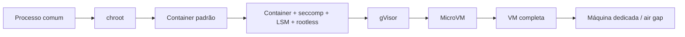

---
tags:
  - ferramentas
aliases:
  - "Espectro de isolamento"
tipo: comparacao
nivel: intermediario
criado: 2026-10-24
relacionados:
  - "[[Comparativo de Ferramentas]]"
  - "[[Isolamento e Contenção]]"
---
# Comparativo por Nível de Isolamento

| Nível | Tecnologias | Compartilha kernel do host? | Indicado para |
|---|---|---|---|
| 1 | chroot, usuário dedicado | Sim | Conveniência |
| 2 | Containers padrão | Sim | Código confiável |
| 3 | Containers endurecidos, Firejail, bwrap | Sim | Código semiconfiável |
| 4 | gVisor | Parcial (poucas syscalls) | Multi-inquilino moderado |
| 5 | MicroVM, Kata | Não | Código hostil, serverless |
| 6 | VM completa | Não | Malware, labs |
| 7 | Hardware dedicado | Não | Risco extremo |

Veja o mapa visual no Canvas **Espectro de isolamento** (pasta Anexos).

## Veja também

- [[Comparativo de Ferramentas]]
- [[Isolamento e Contenção]]
- [[Sandbox vs VM vs Container vs Jail vs chroot]]
- [[MOC - Ferramentas]]
