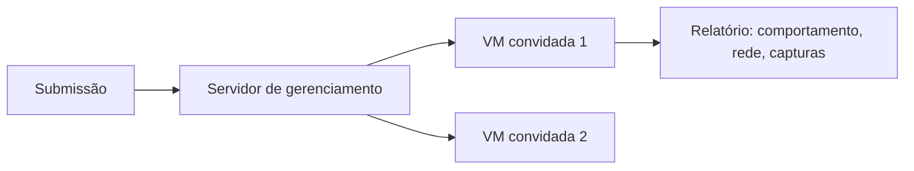

---
tags:
  - malware
  - defensivo
aliases:
  - "CAPEv2"
  - "CAPE Sandbox"
tipo: ferramenta
nivel: avancado
criado: 2026-10-24
relacionados:
  - "[[Comparativo de Ferramentas de Análise de Malware]]"
  - "[[Laboratório de Análise de Malware]]"
---
# Cuckoo e CAPE

> [!warning] Conteúdo estritamente defensivo e educacional
> Não há aqui código malicioso nem instruções para criar, aperfeiçoar ou distribuir malware. Trabalhe só com amostras obtidas legalmente e dentro de um laboratório isolado.

Sandboxes **automatizadas** e auto-hospedadas: enviam a amostra a uma VM, executam, coletam comportamento e geram relatório.

- **Cuckoo Sandbox** (original): referência histórica; o projeto original deixou de ser mantido ativamente.
- **CAPE (CAPEv2):** derivado ativo, com foco em extração de configurações e *payloads* de famílias conhecidas.

> [!question] Verificar na documentação oficial
> Estado de manutenção, versões e requisitos (hipervisor, SO convidado) mudam; consulte a documentação do CAPEv2 e do Cuckoo3.

> [!warning] Hardening do próprio servidor
> O servidor de gerenciamento é um alvo; isole-o e mantenha-o atualizado.

## Veja também

- [[Comparativo de Ferramentas de Análise de Malware]]
- [[Any.Run Joe Sandbox e Hybrid Analysis]]
- [[Laboratório de Análise de Malware]]
- [[MOC - Análise de Malware]]
