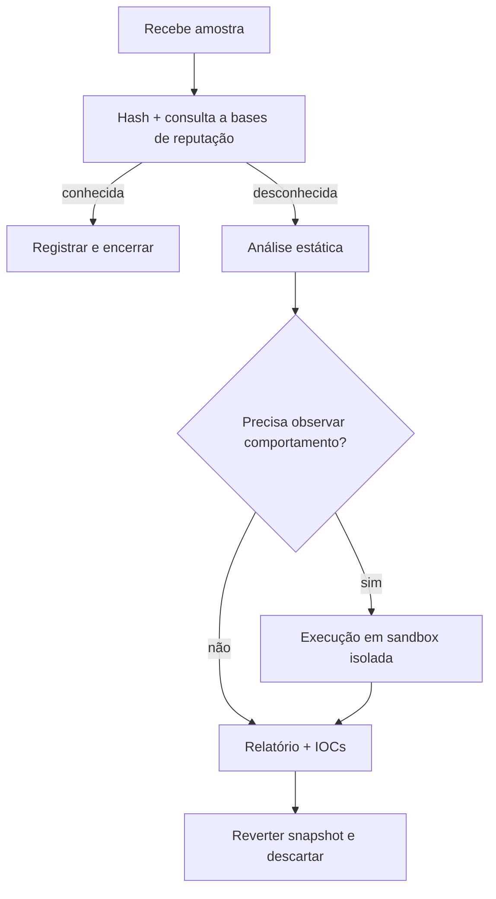

---
tags:
  - malware
  - defensivo
aliases:
  - "Triagem"
tipo: fluxo
nivel: intermediario
criado: 2026-10-24
relacionados:
  - "[[Análise Estática e Dinâmica]]"
  - "[[Relatórios de Análise de Malware]]"
---
# Fluxo de Triagem de Amostras

> [!warning] Conteúdo estritamente defensivo e educacional
> Não há aqui código malicioso nem instruções para criar, aperfeiçoar ou distribuir malware. Trabalhe só com amostras obtidas legalmente e dentro de um laboratório isolado.

> [!warning] Consultar reputação por hash é seguro; enviar o arquivo a serviços públicos nem sempre é — ver [[Any.Run Joe Sandbox e Hybrid Analysis]].

## Veja também

- [[Análise Estática e Dinâmica]]
- [[Relatórios de Análise de Malware]]
- [[Laboratório de Análise de Malware]]
- [[MOC - Análise de Malware]]
